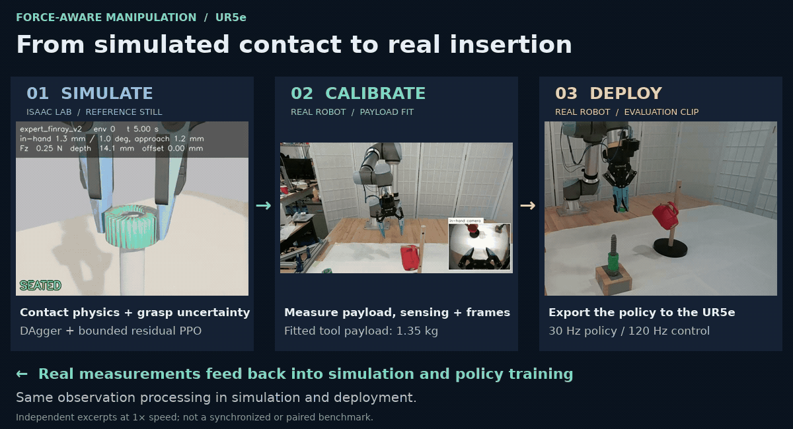
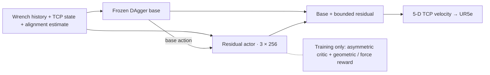
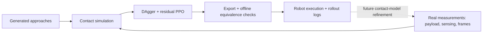
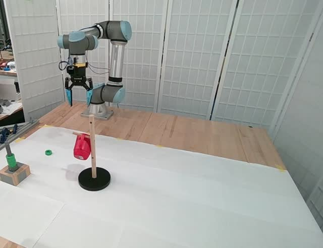
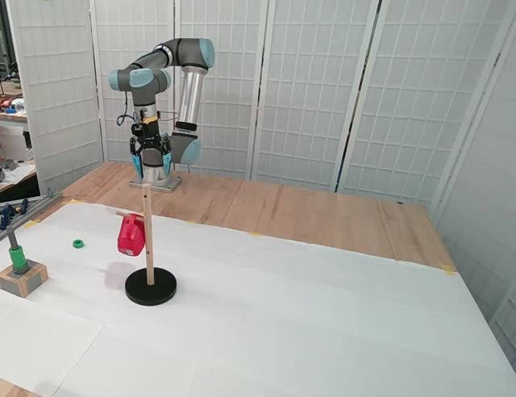

# Force-Aware Sim-to-Real Learning on a UR5e

**A framework for turning generated demonstrations into contact policies: simulate, calibrate, learn corrections, deploy.**

An insertion trajectory can look perfect and still jam when the grasp shifts. This project connects **measurement-informed contact simulation**, **residual reinforcement learning**, and **real-robot inference** so a UR5e can respond to contact instead of only replaying a path.

<p align="center">
  <a href="docs/media/pipeline_overview.mp4">
    
  </a>
  <br>
  <em>Actual project evidence: simulation reference still, real calibration footage and real insertion footage. Independent excerpts at original speed.</em>
</p>

[Watch the overview](docs/media/pipeline_overview.mp4) · [Policy design](#policy-design) · [Reusable framework](#reusable-framework) · [Results](#results) · [Try it](#try-it) · [Documentation](#documentation)

## Highlights

- **Learn corrections with residual PPO.** A frozen DAgger policy supplies the base motion; a bounded residual learns lateral, descent and tilt corrections. A privileged critic supports training while the deployed actor uses the hardware observation pipeline.
- **Design the reward around contact.** Reward geometric seating and alignment-aware progress; penalize excessive wrench, invalid penetration and large or abrupt corrections. Force alone never defines success.
- **Bring real measurements into simulation.** Payload / center of gravity, wrist sensing and fixture registration inform the simulator. Fitting the payload reduced post-tare cross-pose force error from **1.17 to 0.70 N RMS**.
- **Carry one observation contract to the robot.** Numpy policy inference reproduces observation processing and action integration; **10 offline tests** check equivalence and stop behavior before deployment.

Built by [Utkarsh Rai](https://github.com/ur10), extending [Real2Render2Real on the UR5e](https://github.com/ur10/real2render2real-ur5e). Current task: nut-on-rod insertion with a UR5e and Robotiq 2F-85 fin-ray grasp. The reusable measurement and deployment workflow is demonstrated on **one task**; cross-task transfer remains to be evaluated.

<a id="3-learn-contact-recovery-with-residual-ppo"></a>

## Policy design

**Preserve useful nominal behavior; learn how to correct it.** DAgger learns a base policy from a privileged contact expert. Residual PPO then optimizes insertion outcomes while the base stays frozen. The actor's mean starts near zero, and a bounded correction lets it adjust the base action as contact develops.



| Design choice | What it does | Why it matters |
| --- | --- | --- |
| **Residual policy** | `action = clip(base + scale × clip(residual))`; replay is also supported as a base. | Retains the base policy's structure while allowing learned recovery. |
| **Actor / critic separation** | Actor: **67 → 256 → 256 → 256 → 5**. Critic: **73 → 256 → 256 → 256 → 1**, with six extra simulator-state values. | Uses true offset, depth and tilt for value learning without exporting the critic to the robot. |
| **Force history + robot state** | **62-D observation**: eight six-axis wrench samples, commanded/measured TCP offsets, previous action and an alignment estimate; actor also receives the 5-D base action. | Provides contact context without requiring live camera images or a recurrent network. |
| **Contact-aware reward** | Geometric seating bonus + alignment-gated depth progress − excessive wrench − residual size/slew − time. | Encourages insertion and economical corrections while penalizing jams, excessive loads and invalid physics. |

PPO uses a clipped objective and generalized advantage estimation. Hidden layers use ELU for the actor/critic and ReLU for the DAgger student. Deployment uses the actor's deterministic mean at **30 Hz**, integrated into **120 Hz** UR control.

**A critical distinction:** the hardware alignment estimate comes from robot kinematics and cannot observe in-hand slip directly. Some simulation results use an oracle-derived noisy estimate; those experiments are labeled separately below. A privileged critic and an oracle-derived actor input are different assumptions.

[Full architecture, action bounds, reward equations and design rationale →](docs/POLICY_DESIGN.md)

## Reusable framework

**The reusable part is the measurement-to-policy workflow.** Geometry, contact behavior and task success must still be adapted for a new assembly.



| Stage | Reuse from this project | Adapt for a new task |
| --- | --- | --- |
| **Measure** | Payload/sensor characterization, frame checks, fixture registration and logging workflow. | Robot/tool calibration, object and fixture measurements. |
| **Simulate** | Wrench observation chain, physics replay and candidate contact-probe comparison. | Collision geometry, grasp compliance/friction and reset uncertainty. |
| **Learn** | DAgger collection, residual PPO, asymmetric critic and policy export. | Nominal behavior, success detector, reward scales and action limits. |
| **Deploy & evaluate** | Numpy inference, observation-equivalence checks, rollout logging and evaluation protocol. | Robot interface, workspace limits, registration and held-out trial distribution. |

**Implemented:** sensor/payload identification, registered geometry, contact learning, simulated probe matching and deployment tooling. **Next validation:** identify contact parameters from a complete real probe dataset, quantify matched hardware performance, and evaluate a second task. These are research components, not a task-agnostic plug-and-play API.

[Framework walkthrough and calibration workflow →](docs/FRAMEWORK.md) · [Measurement provenance →](docs/CALIBRATION.md)

<a id="results-and-what-they-do-and-do-not-establish"></a>

## Results

| Evidence | Finding | What it establishes |
| --- | --- | --- |
| **Real calibration** | Fitted payload **1.35 kg** vs **1.0 kg** configured; cross-pose force error **1.17 → 0.70 N RMS** after tare. | A measured improvement in payload compensation. |
| **Simulation** | Held-out evaluations below, **128 attempts per condition**. | Policy behavior under the stated simulation and observation assumptions. |
| **Real policy evaluation** | Three recordings with multiple camera views; author-observed residual RL advantage over imitation. | Qualitative footage and a preliminary observation; matched counts, checkpoint labels and force/time logs are pending. |

### Simulation reference

Measured-geometry configuration, fin-ray grasp, **0.5 mm radial clearance**, one training seed per policy:

| Policy | Alignment estimate | Seated / 128 |
| --- | --- | ---: |
| Blind force-limited replay | No learned alignment recovery | **35** |
| DAgger | Deployable kinematic estimate | **78** |
| DAgger | Oracle-derived noisy estimate | **91** |
| Residual PPO on DAgger | Oracle-derived noisy estimate | **93** |

**93/128 versus 78/128 is not a matched RL gain:** the observation assumptions differ. The comparable oracle-estimate rows are 91/128 and 93/128. These numerical policy results are simulation-only; the calibration measurement does not establish a hardware policy-success gain.

### Hardware footage

| Recording 0 | Recording 1 | Recording 2 |
| --- | --- | --- |
| [](docs/media/hardware/group-0.mp4) | [](docs/media/hardware/group-1.mp4) | [](docs/media/hardware/group-2.mp4) |

Click a poster to watch camera view 4. All 15 original camera files are preserved; file counts are not trial counts. The selected footage is not presented as a paired policy comparison.

[Evaluation details, figures and limitations →](docs/EVALUATION.md) · [All footage and provenance →](docs/media/hardware/README.md) · [Raw simulation results →](results/sim_evaluations.json)

## Try it

### Check policy inference without a robot

Requires Python with Numpy. From a clone of this repository:

```bash
python -m pip install numpy
DEPLOY_DATA="$PWD/assets/deploy" python robot_side/deploy/test_deploy.py
```

This runs the **10 offline deployment checks** against included reference data and a stand-in robot; it does not connect to hardware. To assemble the deployment folder and rehearse the controller, use the [robot session guide](robot_side/SESSION_GUIDE.md). Live operation also requires `ur_rtde`, task-specific setup and lab operator approval.

### Run simulation and training

Requires **Isaac Lab 2.0.2 / Isaac Sim 4.5** and a `real2render2real` checkout with the [UR5e overlay](https://github.com/ur10/real2render2real-ur5e) already installed:

```bash
./install.sh /path/to/real2render2real
cd /path/to/real2render2real
.venv/bin/python scripts/ur_contact/test_contact_modules.py
```

[Training and evaluation commands →](contact_sim/README.md) · [Exact experiment invocations →](runs/)

## Documentation

| Start here when you want to… | Read |
| --- | --- |
| Understand policy architecture, PPO settings and reward decisions | [Policy design](docs/POLICY_DESIGN.md) |
| Reuse the measurement / simulation / deployment workflow | [Framework walkthrough](docs/FRAMEWORK.md) and [calibration provenance](docs/CALIBRATION.md) |
| Inspect results, learning curves, footage and remaining limitations | [Evaluation](docs/EVALUATION.md) and [hardware benchmark protocol](docs/HARDWARE_EVALUATION_TEMPLATE.md) |
| Train or change the simulator | [Simulation implementation](contact_sim/README.md), [generator fixes](generator_fix/) and [experiment runs](runs/) |
| Prepare robot-side execution | [Operator session guide](robot_side/SESSION_GUIDE.md) and [probe matching](robot_side/SIM_LIBRARY.md) |
| Trace original decisions and experiments | [Research log](docs/PLAN.md); historical status entries are not current |

## Author, feedback and license

Developed by **[Utkarsh Rai](https://github.com/ur10)**. This work extends the generated demonstrations from [Real2Render2Real](https://real2render2real.com/) into physical contact simulation, measurement-informed sensing, DAgger/residual PPO training and robot deployment. It builds on Isaac Lab, Factory/IndustReal and prior imitation/residual-learning methods; implementation decisions and references are retained in the [research log](docs/PLAN.md).

For bugs, reproduction questions or proposed extensions, [open an issue](https://github.com/ur10/force-sim2real-ur5e/issues). Include the command, environment versions, checkpoint and observation source when reporting an evaluation discrepancy.

**MIT licensed** — see [LICENSE](LICENSE).
