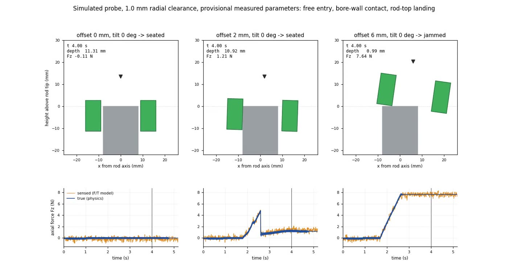
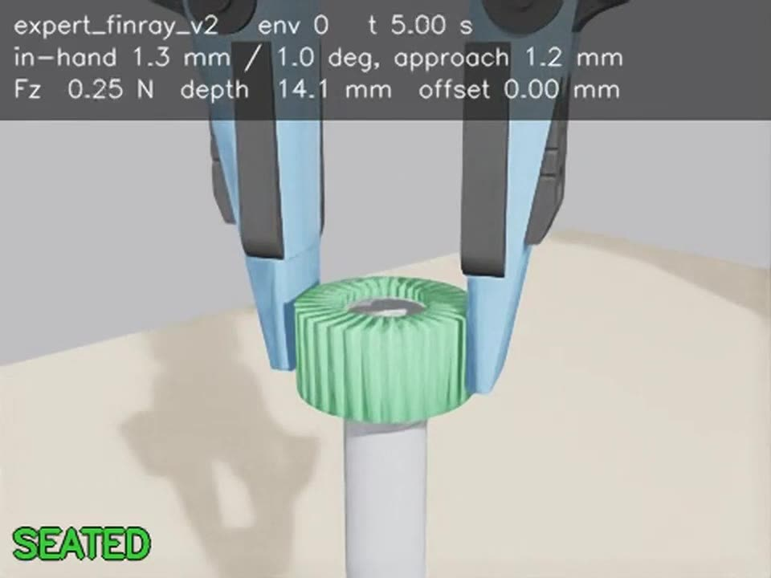
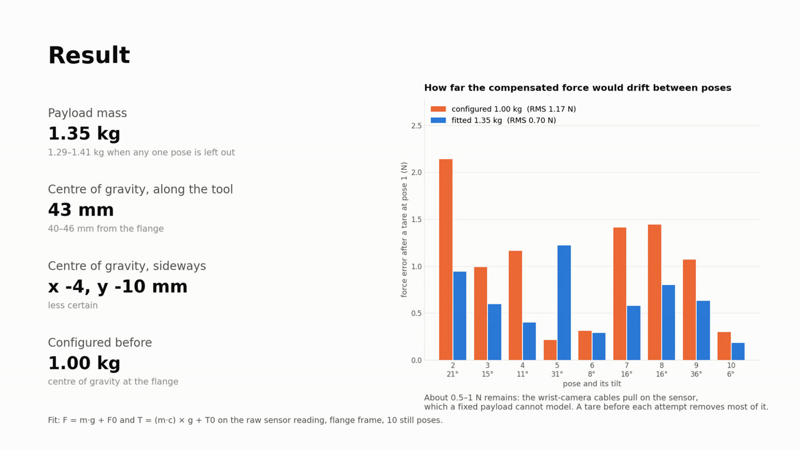

# Force-Aware Sim2Real for Tight-Tolerance Insertion

**A UR5e with a Robotiq 2F-85 (fin-ray fingers) putting a nut on a threaded rod, with policies that
feel for the hole.** This project extends [real2render2real-ur5e](https://github.com/ur10/real2render2real-ur5e),
where one human video became many *kinematic* robot demonstrations. Here those demonstrations get
physics and force sensing:
- a contact simulation of the nut, the fingers and the rod (Isaac Lab / PhysX);
- a model of the UR5e's wrist force/torque sensing, identified against the real arm;
- two learning routes, a privileged teacher with DAgger and residual reinforcement learning;
- the tooling to calibrate the simulation against the bench and to deploy the policies on it.

> **Status (2026-11-22).** All policy results below are **simulation**. On the real robot so far:
> the wrist-sensor and payload identification (real data), the calibration and deployment tooling,
> and its offline tests. Hardware trials of the policies are pending; this README will report them
> with their logs.

<p>

</p>

*Simulation, provisional measured parameters, 0.5 mm radial clearance. Columns: blind replay, the
DAgger student with the deployable offset estimate, the DAgger student, the residual policy on the
student, the privileged expert. Rows: the same four held-out episodes. "Invalid" marks an episode
stopped because the nut sank more than 0.5 mm into the rod (a physics failure, counted as not seated).*

## Why force

In the generated demos the nut follows the tracked path onto the rod and nothing pushes back. With no
in-hand error, 47 of 48 generated demos seat without touching the rod (simulation), so a perfect demo
never teaches contact. On the bench, three things go wrong at once:
- the nut sits a millimetre or two off in the fingers;
- the rod position is known to about as well;
- a tight nut has only 0.5 mm of radial clearance.

Contact then decides the outcome, and the only sensor that sees it is the wrist force/torque.

## What is in this repository

| Path | What |
|---|---|
| `contact_sim/` | The contact simulation, sensor model, privileged expert, DAgger, residual RL (PPO), probes, evaluation (`contact_sim/README.md` lists every file) |
| `robot_side/` | Real-robot side, numpy only: the session guide for an agent on the robot machine, the GELLO collection script with wrench logging, the offline probe check, and `deploy/` (the policy deployment with `ur_rtde`, a stand-in robot for dry runs, 10 offline tests) |
| `generator_fix/` | The fix to the generator that physics replay exposed (held nut checked against the full bolt stand, lifted over the rod tip after the warp), and the trajectory exporter |
| `assets/` | The 49 exported generated nut trajectories, provisional measurements, the simulated probe library, the policy bundles for the robot |
| `results/` | Every simulated held-out evaluation behind the tables below (`sim_evaluations.json`), learning curves, the speed sweep, and the real sensor and payload identification |
| `runs/` | The exact queues that produced the results |
| `docs/PLAN.md` | The working plan and lab notebook, as written |

## Method

**Contact twin.**
- **Rod:** a 64-sided convex frustum with a tip chamfer.
- **Nut:** 32 convex sectors, so the bore stays open.
- **Grip:** the nut hangs from the gripper on a six-axis spring placed in the middle of the band the fin-ray tips pinch. It is stiff across the closing direction and soft for rocking about the line between the two contacts.
- **Solver:** the Factory insertion settings (240 Hz, 192 position iterations, one solver partition).
- **Wrench readout:** taken at the arm–gripper joint; it reads back a known 5.4 N load to 0.016 N.

**Sensor chain.** The policy channel is computed from the simulated contact through the same stages
as the UR's wrist sensing:
1. tool weight;
2. bias and drift;
3. noise;
4. compensation with the configured payload (with mass and centre-of-gravity error);
5. reporting point and frame;
6. 500 Hz sample-and-hold;
7. latency;
8. first-order 20 Hz low-pass;
9. a tare averaging 0.2 s.

**Privileged expert and DAgger.** A hand-written expert sees the true nut-to-rod offset, depth and tilt.
A student MLP (3 × 256) sees only deployable inputs:
- the last 8 sensed wrenches;
- the commanded and measured TCP offsets;
- its previous action;
- an offset estimate.

It outputs a 5-d TCP velocity (x, y, z, rotation rates about x and y). DAgger lets the student drive
and has the expert label every state it visits; four rounds, with the expert share going 100 → 50 →
25 → 0 %.

Lesson learned: the teacher's decisions must be observable to the student. An expert that hovered
until it *knew* it was aligned produced a student that hovers forever (0/128). An expert whose
decisions follow felt contact works: descend, lift until the force releases, step sideways.

The **offset estimate** comes in two kinds:
- **oracle:** the true offset plus a 1 mm per-episode bias and noise, a stand-in for an in-hand tracker;
- **kinematic:** the registered rod position minus where the TCP pose says the nut is, blind to the in-hand error. This is the deployable one.

### The RL technique: residual PPO with an asymmetric critic

- **Residual policy.** A frozen base policy plus a bounded learned correction,
  `a = clip(a_base + s ⊙ clip(π_θ(o, a_base), -1, 1), -1, 1)` with `s = (0.6, 0.6, 0.6, 0.5, 0.5)`.
  The base is either the generated demo's insertion replayed blindly (5 mm/s down, stops pushing
  above 3 N) or a DAgger student. The actor starts near zero, so training starts from the base's behaviour.
- **Algorithm.** PPO:
  - clipped objective (0.2), GAE (γ 0.99, λ 0.95);
  - 5 epochs × 4 minibatches per update, Adam 3e-4 annealed linearly to 10 % over the budget;
  - gradient clip 1.0;
  - Gaussian policy with a learned log-std (initial -1.2), no entropy bonus.
- **Asymmetric actor-critic.** The actor sees only the deployable observation (62-d) and the base
  action. The critic also gets privileged state (offset, depth, tilt, rod in the bore), which exists
  only in simulation and is dropped at deployment. Inputs are normalised with running mean/variance,
  clipped at ±10.
- **Reward.** Potential-based shaping with Φ(s) = -min(|e_xy| / 2 mm, 2) + σ((gap - |e_xy|) / 0.2 mm) · clip(depth / 15 mm, 0, 1),
  which rewards alignment and only rewards depth while the nut is inside the gap. On top of the shaping:
  - +10 for seating, -10 for aborting (40 N) or invalid physics;
  - minus dt · (0.1 + 2 · c_wrench + 0.1 · |residual|² + 0.02 · |Δresidual|²);
  - `c_wrench`: squared excess of each wrench component over a soft limit (5 N lateral, 8 N axial, 0.3 N·m), scaled by the distance to a hard limit (30/40 N, 2 N·m), averaged over every physics sub-step rather than only the policy tick.

  Unit tests check the reward can't be farmed: inserting scores highest, hovering earns no progress,
  touch-and-retreat earns nothing recurring.
- **Rollouts.** 128 parallel environments, 30 Hz policy, 8 s episodes, 48-tick rollouts. Time-limit
  ends are bootstrapped. Updates on chunks with fewer than 32 running samples are skipped: one sample
  gives a NaN advantage std, which poisoned one run before the fix. Episodes reset once every env is done.

**Offline calibration check.** A library of 18 simulated probe sets (clearance × grip stiffness ×
friction, 24 attempts each) is compared with real probe attempts by the same feature code, numpy only,
on the robot machine. From each attempt it reads:
- where contact starts;
- how fast force rises per millimetre of descent;
- the outcome.

Rod-top landings calibrate the grasp length, and outcomes in several directions locate the rod axis.

**Deployment.** `robot_side/deploy/` rebuilds on the real arm exactly the observation the simulated
policies saw:
- **Frames:** the sim's root link is the UR base frame and its `tool0` the UR flange.
- **Wrench:** sign from the wrench check, torque shifted to the sim's TCP point, tare, the same filter.

It runs the policy at 30 Hz with `servoL` at 120 Hz, inside a set of stops:
- force (20 N);
- a workspace box around the entry;
- orientation and tracking limits;
- robot mode;
- the operator's Enter key.

It checks the start pose and waits for confirmation, never moves after an attempt, and asks for the
observed outcome. The student and the residual actor run in plain numpy; no PyTorch is needed on the robot.

## Results (simulation unless marked REAL)

Held-out evaluation: the same 128 episodes (64 envs × 2 rounds, seed 100) for every row of a table;
95 % Wilson intervals; one training seed per policy. Every number is a row of `results/sim_evaluations.json`.

**First parameter set** (placeholder hardware values, rigid-centre grasp model), 0.5 mm clearance:

| Policy | Seated / 128 |
|---|---|
| Privileged expert | 128 |
| Residual RL on blind replay, 90 min | **125** (93–99 %) |
| DAgger student, contact teacher | 67 (44–61 %) |
| same, wrench input removed | 0 |
| same, offset estimate removed | 37 |
| Behaviour cloning only | 16–20 (108–112 aborted) |
| DAgger student, hover teacher | 0 (all wait above the tip) |
| Hand-designed wrench-only controller | 20 |
| Blind force-limited replay | 7 |

**Fin-ray grasp model**, same setup:

| Policy | Seated / 128 |
|---|---|
| Privileged expert | 128 |
| DAgger student (retrained) | **118** (86–96 %) |
| Residual RL on blind replay, 90 min (still rising) | 112 (81–92 %) |
| First-grasp-model residual, run unchanged | 122 |
| DAgger student, no offset estimate | 91 |
| Hand-designed wrench-only controller | 35 |
| Blind force-limited replay | 20 |
| DAgger student, no wrench | 8 |

<p></p>

**Provisional measured parameters** (rod 16 mm threaded with a 1 mm chamfer, nut 32 × 14 mm 8 g,
nut bottom 225 mm below the flange; camera estimates), fin-ray grasp, trained at 0.5 mm:

| Policy | 0.5 mm | 1.0 mm | 2.7 mm | 0.5 mm, identified real sensor |
|---|---|---|---|---|
| Privileged expert | 128 | 128 | 128 | – |
| Residual RL on the DAgger student, 40 min | **93** (64–80 %) | 111 | 128 | 88 |
| DAgger student | 91 (63–78 %) | **115** | 128 | 90 |
| DAgger student, no wrench / no offset estimate | 84 / 60 | – | – | – |
| DAgger student, **deployable (kinematic) estimate** | 78 (52–69 %) | 95 | 128 | 80 |
| Residual RL on blind replay, 40 min | 45 | 64 | 124 | 44 |
| Hand-designed wrench-only controller | 41 | – | – | – |
| Blind force-limited replay | 35 | 50 | 122 | 35 |

What these numbers show:
- **Geometry matters as much as the policy.** With the measured geometry, blind replay and the
  no-wrench student do much better than before. The largest change is the 1 mm tip chamfer, which
  is unmeasured and should be measured; its effect was not isolated in an experiment.
- **Clearance decides whether force feedback matters at all.** At the camera-estimated 2.7 mm, blind
  replay already seats 122/128; at 1 mm or less, the policy decides the outcome.
- **The measured sensor changes nothing material.** Swapping it in moves no policy by more than 5 episodes.
- **The residuals here are budget-limited.** They got 40 minutes, against the 90-minute curve above.
- **Deployment can only use the kinematic estimate.** Residuals trained on the oracle estimate can't
  run on the robot. The deployable residual is one trained on the kinematic-estimate student
  (`contact_sim/README.md`).

**Speed and impedance** (`results/speed_impedance.json`):
- A passive compliant descent (admittance, 2.5–20 mm/s, damping ×0.5–×2) at 0.5 mm seats only the
  centred attempts, 2–5 of 24, at any setting. Its peak force follows damping × speed, up to 13 N.
- The force-regulating privileged expert seats 128/128 at every speed limit from ×0.5 to ×4. Median
  time falls from 5.1 s to 1.1 s while the peak force stays at 2.1–2.7 N.

**Offline calibration check, validated on held-out simulated runs** (`robot_side/SIM_LIBRARY.md`):
- the correct parameter set ranks first;
- a grasp length stated 3 mm too long or 12 mm too short is recovered to 0.05 mm;
- with 1 mm of registration error the true set stays among the three within 10 %, with clearance blurred between 0.5 and 1.0 mm;
- off-grid parameters land on the nearest grid points.

<p>


</p>

**REAL: wrist sensor and payload identification.** Recorded on the UR5e:
- a sensor session, four still holds of 15–19 s at 8–34° tilt after a tare;
- a payload session, ten still poses.

Results (`results/real_sensor.json`, `results/real_payload_fit.json`):

| Parameter | First sensor model | Measured on the UR5e |
|---|---|---|
| Force noise per axis | 0.5 N | 0.11–0.17 N |
| Torque noise per axis | 0.02 N·m | 0.004 N·m |
| Drift | 0.05 N/s | ≤ 0.023 N/s |
| Bias change between orientations, after one tare | – | up to 1.6 N |
| Force while moving freely | 0.35 N RMS (sim jitter) | 0.5–0.74 N std per axis |
| Payload | compensated exactly | 1.35 kg fitted (1.29–1.41 leave-one-out), CoG 43 mm along the tool; 1.0 kg configured |
| Rate | 500 Hz | 500 Hz over RTDE, no drops |

<p></p>

**Physics replay of the generated data found real bugs** before any learning:
- **11/49 generated paths grazed the top 21 mm of the rod.** The planner had checked the arm against a
  rod cut at the placed nut's height and never checked the held nut. Fixed in `generator_fix/`; after
  regenerating, 48/48 pass with 2.90 mm closest approach.
- **~50 N gripper-inertia spikes** came from carries that start mid-motion; a smooth start removed them.
- **Joint speeds above the UR5e's rating:** a median ×1.48.
- **2π jumps of the last wrist joint** in 7–11 of 49 trajectories.
- **Four phantom 1 kg bodies** from the URDF import of massless frames.

**Deployment tooling (offline).** The 10 tests in `robot_side/deploy/test_deploy.py` pass:
1. the rebuilt 62-d observation matches the simulator's at every tick of a logged simulated run, to float32 precision;
2. so do the wrench filter and the action integration;
3. the numpy student and the numpy residual reproduce the PyTorch policies;
4. stand-in-robot episodes seat when aligned, stop pushing on the rod top, and abort on excess force.

## Install and run

Simulation: Isaac Lab 2.0.2 / Isaac Sim 4.5, on top of a real2render2real checkout with the
[real2render2real-ur5e](https://github.com/ur10/real2render2real-ur5e) overlay installed. That overlay
provides the UR5e + Robotiq 2F-85 model, the URDF and USD build, and the nut task.

```bash
./install.sh /path/to/real2render2real          # copies contact_sim, robot_side, the generator fix, assets
cd /path/to/real2render2real
.venv/bin/python scripts/ur_contact/test_contact_modules.py      # offline tests, no Isaac
# training and evaluation commands: contact_sim/README.md; the exact queues used: runs/
```

Robot side (numpy and `ur_rtde`; no Isaac, no PyTorch):

```bash
robot_side/make_robot_folder.sh ~/force_deploy  # deploy/, policy bundles, probe check, session guide, config templates
cd ~/force_deploy                               # set the robot IP in config/robot.yaml
python deploy/test_deploy.py                    # 10 offline tests
python deploy/deploy_policy.py --dry-run -y --policy student     # rehearsal on the stand-in robot
python deploy/deploy_policy.py --policy replay --air-mm 30 -l air_replay   # MOVES THE ROBOT: see SESSION_GUIDE.md step E
```

`robot_side/SESSION_GUIDE.md` is written for a coding agent on the robot machine: it guides the operator
and checks outputs, but never starts anything that moves the arm itself.

## Limitations

- A parallel-jaw gripper with passive fin-ray fingers and the arm's built-in wrist sensing; no tactile sensing.
- **No hardware trials of the policies yet.** All policy results are simulation.
- The geometry is provisional, from camera estimates, and the nut's bore is unmeasured.
- Each policy number comes from one training seed.
- The in-hand spring is elastic, so a real grasp that slips stays slipped while the simulated one springs back.
- The vision input is a stand-in (oracle) or kinematic only; no images.

## References

- J. Yu et al. *Real2Render2Real: Scaling Robot Data Without Dynamics Simulation or Robot Hardware.* 2025.
- Y. Narang et al. *Factory: Fast Contact for Robotic Assembly.* RSS 2022.
- B. Tang et al. *IndustReal: Transferring Contact-Rich Assembly Tasks from Simulation to Reality.* RSS 2023.
- M. Noseworthy et al. *FORGE: Force-Guided Exploration for Robust Contact-Rich Manipulation under Uncertainty.* 2024.
- S. Ross, G. Gordon, D. Bagnell. *A Reduction of Imitation Learning and Structured Prediction to No-Regret Online Learning* (DAgger). AISTATS 2011.
- D. Chen, B. Zhou, V. Koltun, P. Krähenbühl. *Learning by Cheating.* CoRL 2019.
- J. Schulman et al. *Proximal Policy Optimization Algorithms.* 2017.
- T. Johannink et al. / T. Silver et al. *Residual Reinforcement Learning for Robot Control* / *Residual Policy Learning.* 2019 / 2018.

MIT License (see `LICENSE`).
