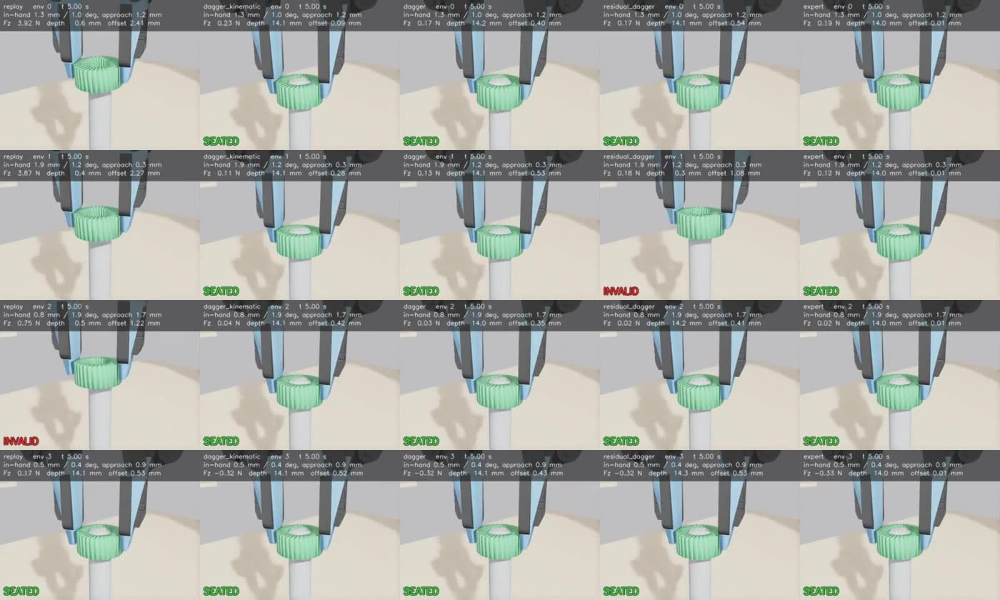
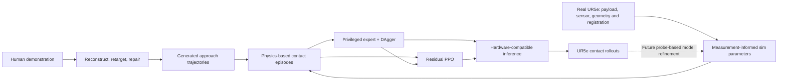
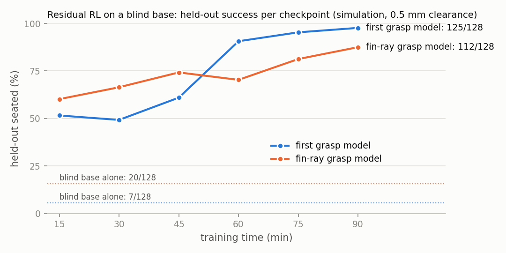

# From Demonstrations to Contact: Calibration-Driven Sim-to-Real Learning on a UR5e

**A force-aware manipulation pipeline that connects generated demonstrations, physical contact simulation, real-robot calibration, imitation learning, and residual reinforcement learning.**

[Project background: Real2Render2Real](https://github.com/ur10/real2render2real-ur5e) · [Research plan and experiment log](docs/PLAN.md) · [Simulation implementation](contact_sim/README.md) · [Hardware evaluation template](docs/HARDWARE_EVALUATION_TEMPLATE.md)

> **Evaluation status · November 23, 2026.** Initial independent hardware testing suggests that the **residual RL policy performs better on the UR5e than the imitation-learning baseline**. This is a preliminary observation supplied by the project author; [Hardware rollout footage is now included](docs/media/hardware/README.md); comparable trial counts, policy/checkpoint labels and force traces have not yet been published. All numerical policy success rates below are **simulation results**, not robot results. Payload, wrist-sensor characterization, rod registration, and deployment equivalence checks have been completed. Full real-contact parameter identification and a controlled hardware benchmark remain future work.

<p align="center">
  
</p>
<p align="center"><em>SIMULATION · Same held-out insertion starts, comparing replay, DAgger, residual RL and a privileged teacher. An invalid physics episode is counted as failure.</em></p>

## The problem: good demonstrations do not teach contact recovery

The preceding [Real2Render2Real project](https://github.com/ur10/real2render2real-ur5e) generated robot trajectories from a human demonstration, using reconstruction, retargeting and trajectory repair. Those demonstrations describe **where the manipulated object should move**—but not how it should respond when a real object jams, tilts or shifts inside the gripper.

For nut-on-rod insertion, a few millimetres of grasp or fixture error can turn an apparently perfect trajectory into a contact failure. In the kinematic demonstration generator, the nut follows a prescribed trajectory without contact forces. With no injected in-hand error, 47/48 physically replayed demonstrations entered without contacting the rod in simulation. Successful demonstrations alone therefore provided almost no examples of recovery.

**Research question:** Can a measurement-informed contact simulator turn generated demonstrations into policies that recover from misalignment on a real robot? And does **residual RL** transfer more effectively than imitating a privileged contact expert?

## At a glance

| Component | Implemented in this repository |
| --- | --- |
| **Robot / task** | UR5e, Robotiq 2F-85 fin-ray grasp, nut insertion over a fixed rod; **not** threaded fastening |
| **Simulation** | Isaac Lab 2.0.2 / Isaac Sim 4.5; contact-capable nut/rod geometry and an in-hand compliance model |
| **Hardware calibration** | Wrist F/T characterization, payload and CoG estimation, robot-frame rod registration, measured geometry |
| **Policies** | Privileged-expert DAgger student; bounded residual PPO on a frozen base policy |
| **Real deployment** | Numpy-only inference, synchronized wrist/pose observations, `ur_rtde`, 30 Hz policy and 120 Hz `servoL` |
| **Evaluation** | Held-out simulation tests with 128 attempts per reported condition; preliminary hardware comparison, quantitative release pending |

## Pipeline



**What transfers from one task to another:** sensor identification, coordinate-frame verification, probe-based parameter comparison, rollout logging, policy export, safety checks and evaluation protocol. **What must change:** task geometry, grasp/contact model, reset distribution, success detector, reference behavior and task-specific reward. This is a reusable **framework architecture**, not yet a cross-task-validated general-purpose solution.

## Four technical contributions

### 1. Turn kinematic demonstrations into physically executable starts

Generated trajectories provide a nominal approach and insertion intent. Before training, physics replay revealed failures invisible in the rendering-only pipeline: **11/49** original paths grazed the upper rod because collision checks omitted the held nut and part of the fixture. After fixing clearance checks and the post-warp lift, **48/48** regenerated paths passed the collision check with a minimum reported clearance of 2.90 mm.

The contact environment then introduces grasp offset, tilt and fixture uncertainty. Unlike kinematic replay, it exposes realistic failure and recovery states to the policy.

### 2. Build the observation model from the real robot outward

The controller does not receive ideal simulated contact force. The simulated wrist observation models tool gravity and payload compensation, bias/drift, sensor noise, reporting frame and reference point, 500 Hz sampling, latency, causal low-pass filtering and a pre-attempt tare. The same feature construction is used in deployment.

**Measured on the UR5e:** See the [calibration provenance table](docs/CALIBRATION.md) for sources and provisional parameters.

| Quantity | Hardware finding | Why it matters |
| --- | --- | --- |
| Tool payload | **1.35 kg** fitted vs **1.0 kg** configured | An incorrect payload creates orientation-dependent force errors |
| Payload center of gravity | **43 mm** along the tool | Changes torque compensation |
| Post-tare compensated force variation across poses | **1.17 N → 0.70 N RMS** using the fitted payload | Less spurious force input from gravity model mismatch |
| Wrist force noise | **0.11–0.17 N per axis** at rest | Sets the useful scale for low-force contact features |
| Wrist torque noise | **~0.004 N·m per axis** | Limits observability of small contact moments |
| Sensor logging | **500 Hz** RTDE, no observed drops in the characterized session | Supports timed alignment of action and force observations |

<p align="center"></p>
<p align="center"><em>REAL HARDWARE · The fitted tool payload is checked across multiple static wrist orientations.</em></p>

<p align="center"></p>

**Fixture registration:** A robot-kinematics-based measurement, from three teleoperated releases, estimates the rod axis in the UR5e base frame. This intentionally does not depend on the available camera hand–eye estimates, which were inconsistent across streams. The experiment also uses measured or image-estimated geometry and grasp length; **the bore and several contact parameters still need direct physical validation**.

<p align="center"></p>
<p align="center"><em>REAL HARDWARE · Rod-axis registration from robot pose logs and release locations.</em></p>

**Probe-based calibration path:** The repository contains an 18-configuration simulated library spanning clearance, effective grip stiffness and friction. A common feature extractor compares contact onset, force-vs-descent slope and seating/jamming outcomes. The ranking mechanism has been checked on **held-out simulation probes**; calibration against a complete real contact-probe dataset is not yet established. See [`robot_side/SIM_LIBRARY.md`](robot_side/SIM_LIBRARY.md).

### 3. Compare imitation with reinforcement learning under contact uncertainty

**DAgger student.** A privileged simulator teacher observes the true nut-to-rod displacement and tilt. It labels states visited by a 3×256 MLP student, while the student uses deployable features: an eight-sample history of six-axis wrist wrench, commanded/measured TCP offsets, previous action and an estimated alignment offset. An important design lesson was that the teacher's *decision to move* must be inferable from the student's observations. A teacher that hovered until privileged alignment was known produced a student that kept hovering; a contact-driven descend–release–shift strategy learned more useful behavior.

**Residual RL.** PPO learns a bounded correction on top of a frozen nominal policy:

\[
 a_t = \operatorname{clip}\!\left(a_{\mathrm{base},t} + s \odot \operatorname{clip}\left(\pi_\theta(o_t,a_{\mathrm{base},t}),-1,1\right),-1,1\right).
\]

The actor uses deployable inputs only. During simulation training, an **asymmetric critic** can additionally see true offset, depth and tilt; the privileged signals are **not used by the actor on hardware**. Reward terms favor successful seating, contact-aware alignment, low excessive wrench and smooth, small corrections. A bounded residual retains the nominal policy's useful structure while allowing closed-loop recovery.

**Why RL might transfer better:** DAgger learns to match the teacher's actions under a modeled set of states. PPO optimizes the downstream outcome over states encountered during its own rollouts. The latter could favor repeated contact-based recovery over exact imitation when real grasp slip, fixture error, filtering or delays depart from the simulator. **This is a hypothesis to test against hardware logs**, not a demonstrated causal explanation.

### 4. Keep the training/deployment observation contract identical

The same observation dimensions, normalization, wrench transforms, causal filtering and action integration are rebuilt for deployment. The robot-side policies run in Numpy without Isaac or PyTorch. The existing offline suite includes **10 deployment tests**, checking observation equivalence to float32 precision, student/residual inference equivalence and simulated stop behavior.

Policy frequency: **30 Hz**; UR control via `servoL`: **120 Hz**. Deployment includes configured workspace and orientation/tracking boundaries, robot-mode checks, operator intervention and a **20 N hardware force stop**. These are operational safeguards, **not a formal safety guarantee**; review the [session guide](robot_side/SESSION_GUIDE.md) before any robot motion.

## Results and what they do (and do not) establish

### Preliminary hardware finding

> **Author-observed:** In an independent evaluation on the physical UR5e, residual RL performed better than the tested imitation-learning policy. A paired benchmark and supporting data—success counts, contact force, elapsed time, offsets, termination reasons and checkpoint identifiers—will be added here. Until then this is a **preliminary qualitative finding**, not a published numerical improvement.

**Why this matters:** A policy that looks comparable to imitation in simulation may behave differently once contact, compliance, sensor artifacts and reset variability come from the physical system. The next experiment is designed to identify the source of that difference.

### Reproducible simulation reference

All results below are **SIMULATION**, measured-parameter configuration, fin-ray grasp, **0.5 mm radial clearance**, 128 held-out episodes per evaluation, one training seed per policy. See [`results/sim_evaluations.json`](results/sim_evaluations.json).

| Policy / observation assumption | Seated / 128 | Interpretation |
| --- | ---: | --- |
| Blind force-limited replay | **35** | Nominal motion without learned recovery |
| DAgger with **deployable kinematic estimate** | **78** | Practical estimator does not know in-hand displacement |
| DAgger with **oracle-derived noisy offset estimate** | **91** | Evaluation assumption not available on the current robot |
| Residual PPO on the **oracle-estimate DAgger base** | **93** | Comparable to the oracle-estimate DAgger row; overlap is substantial |

**Do not compare 93/128 with 78/128 as an RL gain:** those rows use different offset-estimation assumptions. The repo documents a training path for residual PPO on the **kinematic-estimate** DAgger base, but the same-condition held-out evaluation and hardware results should be published together before claiming improvement.

At **2.7 mm clearance** (the physical nut's approximate camera-derived fit), blind replay already succeeded in **122/128** simulated attempts. Tight clearances and deliberately varied grasp/fixture offsets are thus much more informative than nominally easy starts.

<p align="center"></p>
<p align="center"><em>SIMULATION · Learning curves across grasp models. Curves are not direct evidence of hardware transfer.</em></p>

### What the calibration results mean

Sensor identification corrected a real mismatch in the payload model. However, substituting the measured noise/drift model into the reported simulation changed policy outcomes by at most five of 128 episodes in the published conditions. **This does not establish a hardware performance gain from calibration.** The right experiment is a controlled hardware ablation: measured vs deliberately mismatched sensor/contact parameters, with identical actors, training budgets and held-out starts.

## Real-robot evaluation footage

The supplied `force_rollout` footage is now included: **three source groups, five original clips per group**. Group meanings and policy/trial mapping were not supplied, so these are labeled by their original folder names. File counts are not independent trial counts, and no success rates, matched comparisons or force measurements are inferred from the clips.

Click a poster to open the full-speed preview (clip `0` from each group):

| Source group 0 · 26.50 s | Source group 1 · 22.23 s | Source group 2 · 28.43 s |
| --- | --- | --- |
| [](docs/media/hardware/group-0.mp4) | [](docs/media/hardware/group-1.mp4) | [](docs/media/hardware/group-2.mp4) |

[Browse all 15 original clips and provenance](docs/media/hardware/README.md) · [Hardware evaluation protocol](docs/HARDWARE_EVALUATION_TEMPLATE.md)

Preview durations describe the video files, not insertion completion times. Original clips are preserved byte-for-byte; preview copies retain their frames and timing. Checkpoint IDs, outcomes, offsets and synchronized force logs remain to be supplied before a quantitative hardware comparison can be reported.

## Reusable calibration workflow

For a new contact task, the intended workflow is:

1. **Register geometry and frames:** measure the manipulated part, fixture, grasp offset, TCP and sensor reporting frame.
2. **Identify the observation channel:** fit tool mass/CoG, characterize bias/drift/noise, log timestamps and latency, verify wrench axes and moment reference point.
3. **Probe contact:** collect a small, controlled set of offset/tilt/force tests; compare onset, force slope and outcomes against simulated parameter candidates.
4. **Build a variability model:** fit effective grip compliance/friction and randomize around defensible measured ranges rather than arbitrary values.
5. **Learn corrections:** use nominal demonstrations and an imitation or residual RL policy; keep privileged state on the training side only.
6. **Validate on robot:** run paired starts, monitor limits, log failure modes and report both completion and force/cycle-time costs. Feed new identification data back into the simulator.

**Built and evidenced here:** the measurement and registration tools, contact simulator, candidate-probe comparison software, training approaches and deployable inference. **Not yet demonstrated:** a completed real-contact parameter fit followed by zero-shot transfer across multiple independent tasks or robots.

## Repository guide

| Directory | Contents |
| --- | --- |
| [`contact_sim/`](contact_sim/) | Isaac contact environment, wrench sensor, DAgger, residual PPO, training and evaluation |
| [`robot_side/`](robot_side/) | Calibration capture, probe comparison, Numpy deployment, offline tests and operator guide |
| [`generator_fix/`](generator_fix/) | Collision and trajectory export improvements found during physics replay |
| [`assets/`](assets/) | Demonstration trajectories, configuration measurements, rod registration and policy bundles |
| [`results/`](results/) | Sim evaluation JSON and measured sensor/payload results |
| [`runs/`](runs/) | Queues and experiment invocations |
| [`docs/PLAN.md`](docs/PLAN.md) | Original working plan and dated lab notebook (historical status updates are not current) |

## Reproduce the implementation

**Simulation** requires Isaac Lab 2.0.2 / Isaac Sim 4.5 and a compatible [`real2render2real-ur5e`](https://github.com/ur10/real2render2real-ur5e) checkout, which provides the UR5e / Robotiq models and task assets.

```bash
./install.sh /path/to/real2render2real
cd /path/to/real2render2real
.venv/bin/python scripts/ur_contact/test_contact_modules.py
# Training, held-out evaluation and exact example commands: contact_sim/README.md and runs/
```

Robot-side **offline checks** (do not move the robot):

```bash
robot_side/make_robot_folder.sh ~/force_deploy
cd ~/force_deploy
python deploy/test_deploy.py
python deploy/deploy_policy.py --dry-run -y --policy student
```

**Do not run live robot commands without checking `robot_side/SESSION_GUIDE.md`, establishing hardware stops and completing lab operator approval.**

## Limitations and next measurements

- Initial hardware advantage of residual RL is **not yet quantified publicly**; publish matched trials, initialization distribution, training seed, policy/checkpoint IDs, confidence intervals and force/time trade-offs.
- Most numeric policy evaluations have **one training seed**; uncertainty intervals across evaluation episodes are not training-seed variability.
- Printed part bore / grip slip / friction / dynamics need direct real-contact validation. Current elastic in-hand spring does not reproduce irreversible grasp slip.
- The full vision-conditioned approach-and-contact policy is **not implemented** here; the deployable policy currently uses a kinematic offset estimate, not live camera images.
- The framework is demonstrated on **one UR5e contact task**. Cross-task portability remains a design goal rather than a verified result.
- Higher success with RL can be accompanied by **higher peak forces**; report force, safety stops and time alongside seating rate.

## Related work

This project builds on [Real2Render2Real](https://real2render2real.com/), Factory, IndustReal, DAgger, asymmetric actor-critic methods and residual reinforcement learning. Detailed methods, decisions and references are retained in [`docs/PLAN.md`](docs/PLAN.md) and [`contact_sim/README.md`](contact_sim/README.md).

MIT license — see [`LICENSE`](LICENSE).
