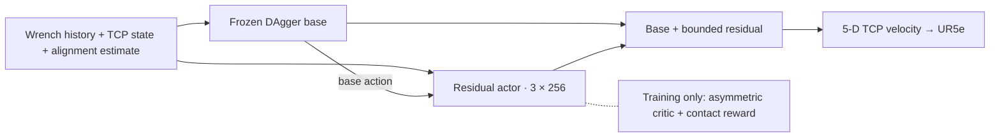
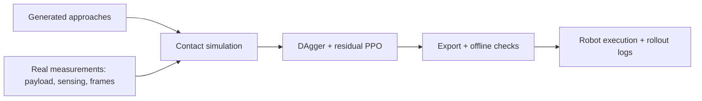
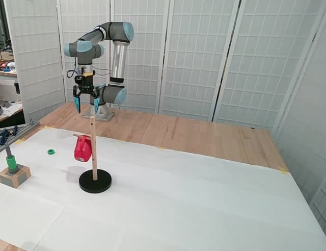

# Force-Aware Sim-to-Real Learning on a UR5e

**Simulate contact. Calibrate from real measurements. Learn corrections. Deploy.**

An insertion trajectory can look clean and still jam when a part shifts in the gripper. This project adds **contact-aware policies and real-measurement calibration** to generated demonstrations, connecting simulation and learning to execution on a physical UR5e.

- **Task:** Nut-on-rod insertion with a Robotiq 2F-85 fin-ray gripper
- **Learning:** Residual PPO over a frozen DAgger policy
- **Control:** 30 Hz deterministic policy inference with a 120 Hz UR control loop

<p align="center">
  <a href="docs/media/pipeline_overview.mp4">
    
  </a>
  <br>
  <em>Simulation reference, real payload calibration and UR5e insertion at 1× speed.</em>
</p>

[Policy design](#policy-design) · [Workflow](#reusable-workflow) · [Results](#results) · [Setup & testing](#try-it) · [Documentation](#documentation)

## Key components

- **Residual PPO over DAgger.** A frozen base supplies nominal motion while a bounded residual learns lateral, descent and tilt corrections. An asymmetric critic uses simulator state during training; the deployed policy runs on the hardware observation pipeline.
- **Contact-aware reward.** Geometric seating and alignment-gated depth progress drive the task. Wrench, penetration and correction penalties discourage excessive loads, invalid contact and abrupt motion.
- **Measurement-informed simulation.** Fitted payload, center of gravity, wrist sensing and fixture registration feed back into the simulator. Payload fitting reduced post-tare cross-pose force error from **1.17 to 0.70 N RMS**.
- **NumPy deployment.** Exported inference preserves observation processing and action integration, with **10 offline tests** covering numerical equivalence and stop behavior.

<a id="3-learn-contact-recovery-with-residual-ppo"></a>

## Policy design

DAgger trains a base policy from a privileged contact expert. Residual PPO learns corrections on top while keeping that base frozen. The residual actor starts with a near-zero mean, then learns how to adjust the nominal action as contact develops.



### Architecture

| Component | Design |
| --- | --- |
| **Observation** | **62 values:** eight six-axis wrench samples, commanded/measured TCP offsets, previous action, XY alignment estimate and its availability flag |
| **DAgger base** | `62 → 256 → 256 → 256 → 5` · ReLU hidden layers |
| **Residual actor** | `67 → 256 → 256 → 256 → 5` · observation + base action · ELU hidden layers |
| **Training critic** | `73 → 256 → 256 → 256 → 1` · six additional simulator-state values for offset, depth, tilt and bore entry |
| **Action** | Five TCP velocities: lateral X/Y, vertical Z and tilt about X/Y |

```text
action = clip(base_action + residual_scale × clip(residual))
```

PPO uses a clipped objective and generalized advantage estimation (GAE). Training samples a Gaussian policy; deployment uses its deterministic mean. The hardware alignment estimate comes from robot kinematics and the registered fixture position.

### Reward design

```text
reward = seating bonus + alignment-gated progress
         − excessive wrench − hard failure
         − correction size − correction slew − elapsed time
```

| Design decision | Purpose |
| --- | --- |
| **Geometric seating defines success** | Reward insertion depth and bore entry rather than contact force alone. |
| **Depth progress is gated by alignment** | Favor alignment before pushing deeper into contact. |
| **Wrench cost is averaged over physics substeps** | Account for loads between policy updates. |
| **Residual size and slew carry a cost** | Encourage small, smooth corrections that retain useful base behavior. |

[Architecture, action bounds, reward equations and PPO settings →](docs/POLICY_DESIGN.md)

<a id="reusable-framework"></a>

## Reusable workflow

The framework connects **measurement → simulation → learning → robot execution**. Reuse the calibration, training and deployment components, then configure the geometry and contact objective for the assembly.



| Stage | Reusable components | Task configuration |
| --- | --- | --- |
| **Measure** | Payload/sensor fitting, frame checks, registration and logging | Tool, part and fixture measurements |
| **Simulate** | Wrench observation chain, physics replay and probe comparison | Collision geometry, grasp compliance, friction and reset ranges |
| **Learn** | DAgger, residual PPO, asymmetric critic and policy export | Base behavior, success detector, reward weights and action limits |
| **Deploy & evaluate** | NumPy inference, equivalence checks, rollout logging and evaluation protocol | Robot interface, workspace limits and test conditions |

[Framework walkthrough →](docs/FRAMEWORK.md) · [Calibration measurements →](docs/CALIBRATION.md)

<a id="results-and-what-they-do-and-do-not-establish"></a>

## Results

### Payload calibration

| Measurement | Result |
| --- | --- |
| Fitted tool payload | **1.35 kg**, versus 1.0 kg configured |
| Fitted center of gravity | **43 mm** along the tool |
| Post-tare cross-pose force error | **1.17 → 0.70 N RMS** |

### Simulation benchmark

Fin-ray grasp, **0.5 mm radial clearance**, **128 held-out attempts** per condition and one training seed per policy. Results are grouped by alignment input:

| Alignment input | Policy | Seated / 128 |
| --- | --- | ---: |
| No learned alignment recovery | Blind force-limited replay | **35** |
| Kinematic estimate | DAgger | **78** |
| Oracle-derived noisy estimate | DAgger | **91** |
| Oracle-derived noisy estimate | Residual PPO on DAgger | **93** |

### Real-robot rollouts

Initial hardware testing showed a qualitative advantage for residual RL over the imitation baseline. Watch the insertion recordings below:

| Recording 0 | Recording 1 | Recording 2 |
| --- | --- | --- |
| [](docs/media/hardware/group-0.mp4) | [](docs/media/hardware/group-1.mp4) | [](docs/media/hardware/group-2.mp4) |

Click a poster to watch the side view. [Browse all camera views →](docs/media/hardware/README.md)

[Evaluation methods and context →](docs/EVALUATION.md) · [Raw simulation results →](results/sim_evaluations.json)

## Try it

### Offline inference tests

Requires Python and NumPy. From the repository root:

```bash
python -m pip install numpy
DEPLOY_DATA="$PWD/assets/deploy" python robot_side/deploy/test_deploy.py
```

Runs **10 checks** against included reference data and a mock robot. For deployment setup, controller rehearsal and hardware operation, follow the [robot session guide](robot_side/SESSION_GUIDE.md).

### Simulation and training

Requires **Isaac Lab 2.0.2 / Isaac Sim 4.5** and a `real2render2real` checkout with the [UR5e overlay](https://github.com/ur10/real2render2real-ur5e) installed:

```bash
./install.sh /path/to/real2render2real
cd /path/to/real2render2real
.venv/bin/python scripts/ur_contact/test_contact_modules.py
```

[Training and evaluation commands →](contact_sim/README.md) · [Experiment invocations →](runs/)

## Documentation

| Topic | Read |
| --- | --- |
| Policy architecture and reward design | [Policy design](docs/POLICY_DESIGN.md) |
| Workflow and calibration | [Framework](docs/FRAMEWORK.md) · [Measurements](docs/CALIBRATION.md) |
| Evaluation and hardware protocol | [Results and analysis](docs/EVALUATION.md) · [Benchmark protocol](docs/HARDWARE_EVALUATION_TEMPLATE.md) |
| Simulation and experiments | [Implementation](contact_sim/README.md) · [Generator fixes](generator_fix/) · [Runs](runs/) |
| Robot execution | [Session guide](robot_side/SESSION_GUIDE.md) · [Probe matching](robot_side/SIM_LIBRARY.md) |
| Experiment history | [Research log](docs/PLAN.md) |

## Author and license

Developed by **[Utkarsh Rai](https://github.com/ur10)**, extending [Real2Render2Real on the UR5e](https://github.com/ur10/real2render2real-ur5e) with contact simulation, calibration, policy learning and robot deployment. Built on Isaac Lab, Factory/IndustReal and prior imitation/residual-RL work; references are in the [research log](docs/PLAN.md).

Questions, bugs or ideas? [Open an issue](https://github.com/ur10/force-sim2real-ur5e/issues).

Licensed under [MIT](LICENSE).
