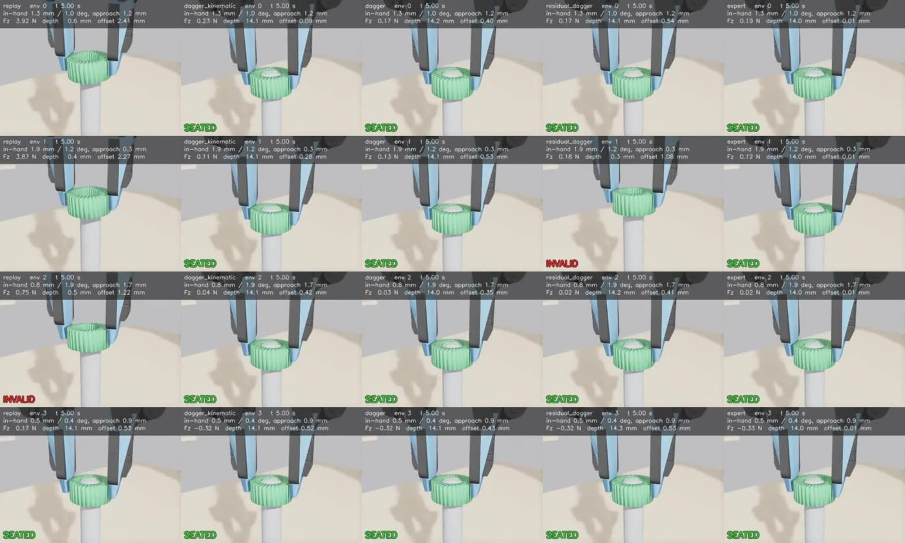
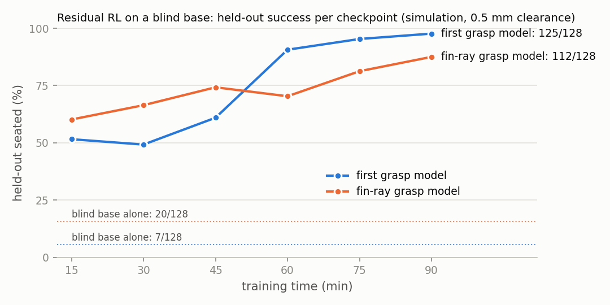
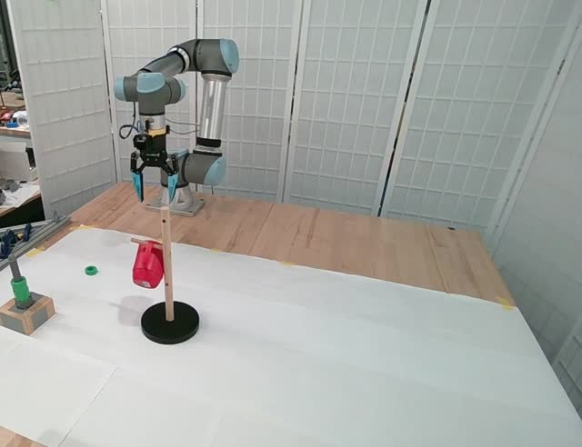
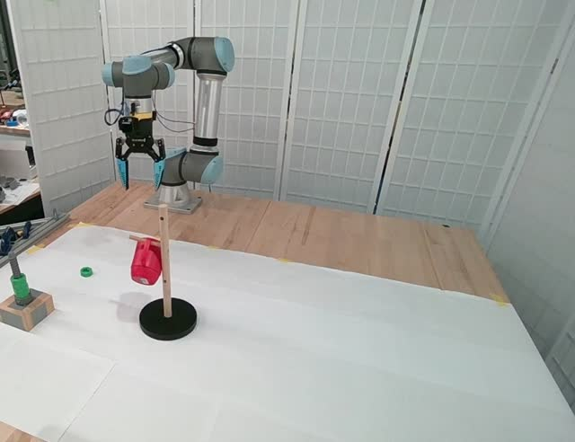
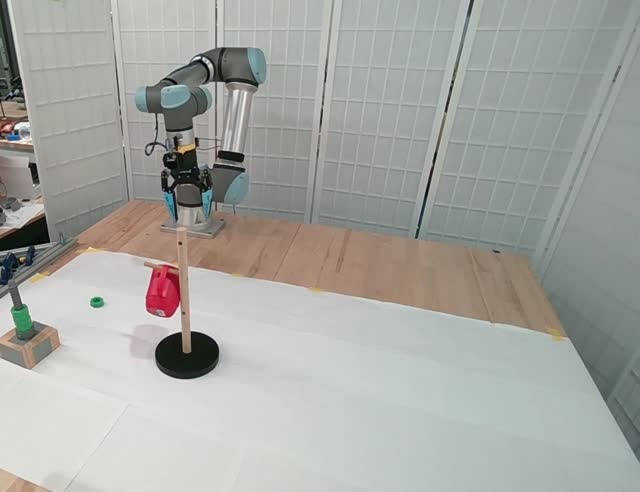

# Evaluation: evidence and limitations

## Preliminary hardware finding

> **Author-observed:** In an independent evaluation on the physical UR5e, residual RL performed better than the tested imitation-learning policy. A paired benchmark and supporting data—success counts, contact force, elapsed time, offsets, termination reasons and checkpoint identifiers—will be added here. Until then this is a **preliminary qualitative finding**, not a published numerical improvement.

**Why this matters:** A policy that looks comparable to imitation in simulation may behave differently once contact, compliance, sensor artifacts and reset variability come from the physical system. The next experiment is designed to identify the source of that difference.

## Reproducible simulation reference

  

<em>SIMULATION · Same held-out insertion starts, comparing replay, DAgger, residual RL and a privileged teacher. An invalid physics episode is counted as failure.</em>

All results below are **SIMULATION**, measured-parameter configuration, fin-ray grasp, **0.5 mm radial clearance**, 128 held-out episodes per evaluation, one training seed per policy. See [`results/sim_evaluations.json`](../results/sim_evaluations.json).

| Policy / observation assumption | Seated / 128 | Interpretation |
| --- | ---: | --- |
| Blind force-limited replay | **35** | Nominal motion without learned recovery |
| DAgger with **deployable kinematic estimate** | **78** | Practical estimator does not know in-hand displacement |
| DAgger with **oracle-derived noisy offset estimate** | **91** | Evaluation assumption not available on the current robot |
| Residual PPO on the **oracle-estimate DAgger base** | **93** | Comparable to the oracle-estimate DAgger row; overlap is substantial |

**Do not compare 93/128 with 78/128 as an RL gain:** those rows use different offset-estimation assumptions. The repo documents a training path for residual PPO on the **kinematic-estimate** DAgger base, but the same-condition held-out evaluation and hardware results should be published together before claiming improvement.

At **2.7 mm clearance** (the physical nut's approximate camera-derived fit), blind replay already succeeded in **122/128** simulated attempts. Tight clearances and deliberately varied grasp/fixture offsets are thus much more informative than nominally easy starts.

<em>SIMULATION · Learning curves across grasp models. Curves are not direct evidence of hardware transfer.</em>

## What the calibration results mean

Sensor identification corrected a real mismatch in the payload model. However, substituting the measured noise/drift model into the reported simulation changed policy outcomes by at most five of 128 episodes in the published conditions. **This does not establish a hardware performance gain from calibration.** The right experiment is a controlled hardware ablation: measured vs deliberately mismatched sensor/contact parameters, with identical actors, training budgets and held-out starts.

## Real-robot evaluation footage

The supplied `force_rollout` footage is now included: **three source groups, five original clips per group**. The numbered clip files provide camera views; the previews use **camera view `4`**, selected for its clear side view of the gripper, nut and rod. Recordings retain their original folder names; policy/checkpoint labels have not been supplied. File counts are not independent trial counts, and no success rates, matched comparisons or force measurements are inferred from the clips.

Click a poster to open the full-speed preview (camera view `4` from each group):

| Recording 0 · 26.53 s | Recording 1 · 22.27 s | Recording 2 · 28.43 s |
| --- | --- | --- |
|  |  |  |

[Browse all 15 original clips and provenance](media/hardware/README.md) · [Hardware evaluation protocol](HARDWARE_EVALUATION_TEMPLATE.md)

Preview durations describe the video files, not insertion completion times. Original clips are preserved byte-for-byte; preview copies retain their frames and timing. Checkpoint IDs, outcomes, offsets and synchronized force logs remain to be supplied before a quantitative hardware comparison can be reported.

## Limitations and next measurements

- Initial hardware advantage of residual RL is **not yet quantified publicly**; publish matched trials, initialization distribution, training seed, policy/checkpoint IDs, confidence intervals and force/time trade-offs.
- Most numeric policy evaluations have **one training seed**; uncertainty intervals across evaluation episodes are not training-seed variability.
- Printed part bore / grip slip / friction / dynamics need direct real-contact validation. Current elastic in-hand spring does not reproduce irreversible grasp slip.
- The full vision-conditioned approach-and-contact policy is **not implemented** here; the deployable policy currently uses a kinematic offset estimate, not live camera images.
- The framework is demonstrated on **one UR5e contact task**. Cross-task portability remains a design goal rather than a verified result.
- Higher success with RL can be accompanied by **higher peak forces**; report force, safety stops and time alongside seating rate.

[← Project overview](../README.md) · [Policy design](POLICY_DESIGN.md) · [Hardware evaluation protocol](HARDWARE_EVALUATION_TEMPLATE.md)
