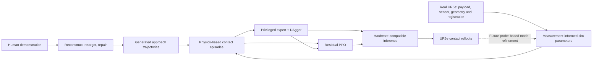
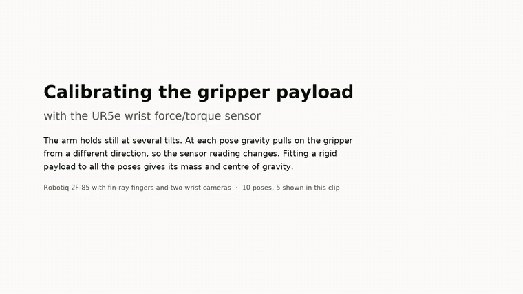
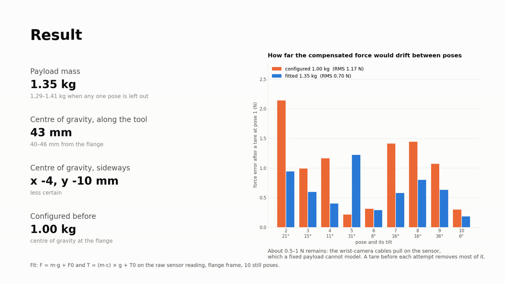
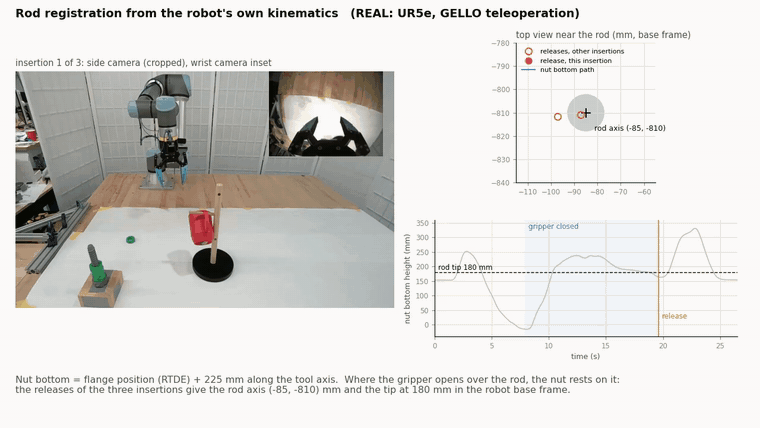

# Framework: measurements, contact simulation and deployment

This research framework connects generated approach trajectories, real measurements, contact learning and robot-compatible inference. The current implementation targets one UR5e nut-on-rod task; reusable components and task-specific work are distinguished in the [project overview](../README.md#reusable-framework).

## The problem: good demonstrations do not teach contact recovery

The preceding [Real2Render2Real project](https://github.com/ur10/real2render2real-ur5e) generated robot trajectories from a human demonstration, using reconstruction, retargeting and trajectory repair. Those demonstrations describe **where the manipulated object should move**—but not how it should respond when a real object jams, tilts or shifts inside the gripper.

For nut-on-rod insertion, a few millimetres of grasp or fixture error can turn an apparently perfect trajectory into a contact failure. In the kinematic demonstration generator, the nut follows a prescribed trajectory without contact forces. With no injected in-hand error, 47/48 physically replayed demonstrations entered without contacting the rod in simulation. Successful demonstrations alone therefore provided almost no examples of recovery.

**Research question:** Can a measurement-informed contact simulator turn generated demonstrations into policies that recover from misalignment on a real robot? And does **residual RL** transfer more effectively than imitating a privileged contact expert?

## Pipeline

**What transfers from one task to another:** sensor identification, coordinate-frame verification, probe-based parameter comparison, rollout logging, policy export, safety checks and evaluation protocol. **What must change:** task geometry, grasp/contact model, reset distribution, success detector, reference behavior and task-specific reward. This is a reusable **framework architecture**, not yet a cross-task-validated general-purpose solution.

## Turn kinematic demonstrations into physically executable starts

Generated trajectories provide a nominal approach and insertion intent. Before training, physics replay revealed failures invisible in the rendering-only pipeline: **11/49** original paths grazed the upper rod because collision checks omitted the held nut and part of the fixture. After fixing clearance checks and the post-warp lift, **48/48** regenerated paths passed the collision check with a minimum reported clearance of 2.90 mm.

The contact environment then introduces grasp offset, tilt and fixture uncertainty. Unlike kinematic replay, it exposes realistic failure and recovery states to the policy.

## Build the observation model from the real robot outward

The controller does not receive ideal simulated contact force. The simulated wrist observation models tool gravity and payload compensation, bias/drift, sensor noise, reporting frame and reference point, 500 Hz sampling, latency, causal low-pass filtering and a pre-attempt tare. The same feature construction is used in deployment.

**Measured on the UR5e:** See the [calibration provenance table](CALIBRATION.md) for sources and provisional parameters.

| Quantity | Hardware finding | Why it matters |
| --- | --- | --- |
| Tool payload | **1.35 kg** fitted vs **1.0 kg** configured | An incorrect payload creates orientation-dependent force errors |
| Payload center of gravity | **43 mm** along the tool | Changes torque compensation |
| Post-tare compensated force variation across poses | **1.17 N → 0.70 N RMS** using the fitted payload | Less spurious force input from gravity model mismatch |
| Wrist force noise | **0.11–0.17 N per axis** at rest | Sets the useful scale for low-force contact features |
| Wrist torque noise | **~0.004 N·m per axis** | Limits observability of small contact moments |
| Sensor logging | **500 Hz** RTDE, no observed drops in the characterized session | Supports timed alignment of action and force observations |

<em>REAL HARDWARE · The fitted tool payload is checked across multiple static wrist orientations.</em>

**Fixture registration:** A robot-kinematics-based measurement, from three teleoperated releases, estimates the rod axis in the UR5e base frame. This intentionally does not depend on the available camera hand–eye estimates, which were inconsistent across streams. The experiment also uses measured or image-estimated geometry and grasp length; **the bore and several contact parameters still need direct physical validation**.

<em>REAL HARDWARE · Rod-axis registration from robot pose logs and release locations.</em>

**Probe-based calibration path:** The repository contains an 18-configuration simulated library spanning clearance, effective grip stiffness and friction. A common feature extractor compares contact onset, force-vs-descent slope and seating/jamming outcomes. The ranking mechanism has been checked on **held-out simulation probes**; calibration against a complete real contact-probe dataset is not yet established. See [`robot_side/SIM_LIBRARY.md`](../robot_side/SIM_LIBRARY.md).

## Keep the training/deployment observation contract identical

The same observation dimensions, normalization, wrench transforms, causal filtering and action integration are rebuilt for deployment. The robot-side policies run in Numpy without Isaac or PyTorch. The existing offline suite includes **10 deployment tests**, checking observation equivalence to float32 precision, student/residual inference equivalence and simulated stop behavior.

Policy frequency: **30 Hz**; UR control via `servoL`: **120 Hz**. Deployment includes configured workspace and orientation/tracking boundaries, robot-mode checks, operator intervention and a **20 N hardware force stop**. These are operational safeguards, **not a formal safety guarantee**; review the [session guide](../robot_side/SESSION_GUIDE.md) before any robot motion.

## Reusable calibration workflow

For a new contact task, the intended workflow is:

1. **Register geometry and frames:** measure the manipulated part, fixture, grasp offset, TCP and sensor reporting frame.
2. **Identify the observation channel:** fit tool mass/CoG, characterize bias/drift/noise, log timestamps and latency, verify wrench axes and moment reference point.
3. **Probe contact:** collect a small, controlled set of offset/tilt/force tests; compare onset, force slope and outcomes against simulated parameter candidates.
4. **Build a variability model:** fit effective grip compliance/friction and randomize around defensible measured ranges rather than arbitrary values.
5. **Learn corrections:** use nominal demonstrations and an imitation or residual RL policy; keep privileged state on the training side only.
6. **Validate on robot:** run paired starts, monitor limits, log failure modes and report both completion and force/cycle-time costs. Feed new identification data back into the simulator.

**Built and evidenced here:** the measurement and registration tools, contact simulator, candidate-probe comparison software, training approaches and deployable inference. **Not yet demonstrated:** a completed real-contact parameter fit followed by zero-shot transfer across multiple independent tasks or robots.

[← Project overview](../README.md) · [Policy design](POLICY_DESIGN.md) · [Calibration provenance](CALIBRATION.md)
