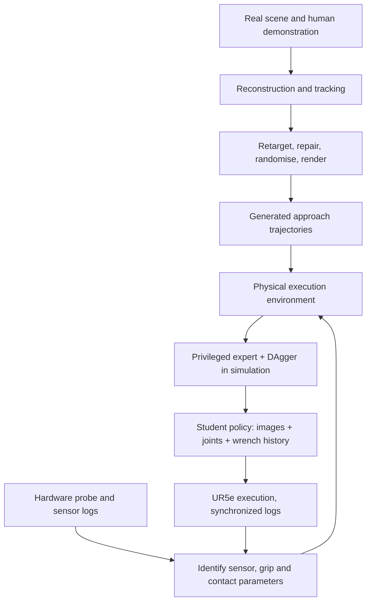

> Working plan and lab notebook of the project, kept as it was written (2026-11-18 to 11-22). Paths under `outputs/` refer to the run directories of the machine the runs were made on; they are not part of this repository (the numbers are in `results/`). All policy results in it are simulation.

# From Generated Demonstrations to Force-Aware Sim2Real on UR5e

**Complete plan: extend the Real2Render2Real demonstration pipeline with physical execution, a
calibrated simulated wrist sensor, and a force-aware policy for contact-rich insertion on a UR5e
with a Robotiq 2F-85.**

> **Status (2026-11-21).** The simulation side is built and runs (`scripts/ur_contact/`), with
> every hardware-dependent number still a placeholder or an RGB fit. **No hardware data has been
> collected, nothing is calibrated, and no result below is a robot result.** Planned work,
> kinematic results, physics-simulation results and hardware results are labelled separately
> throughout. Origin: `real2_render.md` (the first version of this plan) merged with the revised
> plan, the route chosen since (privileged expert + DAgger), and what the simulation has shown.

## Claim

The human video cannot give forces; it only shows where things go. The forces come from running
those motions with physics against the measured fixture, through a simulated sensor tuned to match
the real UR5e. **The video supplies the task and the approach, physics supplies the contact, and
calibration makes the simulated forces look like the real ones.** The paper's claim is phrased
that way.

Central question (from the first plan, still the headline experiment):

> Does calibrating a physical simulator from a small amount of real interaction data improve the
> transfer of a force-aware policy built on generated demonstrations?

Supporting questions:

1. Which generated demonstrations remain executable when contact is governed by physics?
2. Does wrench feedback improve learned corrections beyond vision and proprioception alone?
3. Does demonstration-guided training reduce the exploration and training cost of learning contact
   recovery?

Success means a measured improvement in hardware task completion, contact behaviour or cycle time
under held-out conditions. A convincing replay or a higher training return alone is not evidence.

## Status at a glance

| Step | What | Needs hardware | State |
|---|---|---|---|
| 0 | Measure nut, rod, chamfer, threads; print graded rings | yes (calipers, printer) | **provisional** (2026-11-22, camera estimates, `outputs/ur_nut/contact/measured.json`); bore and calipers open |
| 1 | Characterise the real F/T signal, push tests at known offsets | yes (robot session) | sensor + payload sessions **recorded** (2026-11-22, below); registration and attempts open |
| 2 | Physics environment (robot, rod, ring on an in-hand spring) | no | **built** (`ring_rod_sim.py`) |
| 3 | Simulated controller (admittance + IK on the commanded joints) | tuning only | **built** (`admittance.py`, `torch_fk.py`); delay/stiffness to identify |
| 4 | Simulated sensor chain | parameters only | **built** (`wrench_sensor.py`); noise, drift, payload **identified** (below); latency, frame open |
| 5 | Validate the sensor model against the real probe | yes (step 1 data) | offline check **built and on the robot machine** (`robot_side/probe_check.py`, 18-entry simulated library); waiting for attempts |
| 6 | Generate the dataset (errors, physics, expert, rendering) | no | contact-phase state dataset **built** (DAgger shards); image rendering not yet |
| 7 | Train the policy (privileged expert + DAgger, then BC on images + wrench) | no | DAgger and residual RL **done** in simulation, with both grasp models (fin-ray: 92% and 88% held-out at 0.5 mm, below); images not yet |
| 8 | Evaluate on the real robot across the clearance ladder | yes | not started |

Already done on the existing pipeline: the nut planner bug that let generated paths graze the rod
is fixed and the nut dataset regenerated (48/48, see Findings); generated trajectories are exported
for physical execution (`outputs/ur_nut/physical_export/`).

## Existing work to preserve

The existing project provides scene reconstruction, calibration, object tracking, robot
integration, demonstration retargeting, obstacle-aware repair, randomised rendering and visual
imitation learning.

- [Project page](https://ur10.github.io/projects/real2render2real/)
- [Existing repository](https://github.com/ur10/real2render2real-ur5e)
- [Related residual-policy work](https://github.com/ur10/residual-pointcloud-adaptation)

The policy experiments on the project page use a rendered, kinematic twin: the object follows the
gripper during replay. The ring/nut examples establish tracking and planning capability; they are
not physical policy evaluations.

Keep that generator intact and add a physical execution environment that consumes its
trajectories, camera configuration, robot description and scene assets.

| Component | Reuse | Extension |
| --- | --- | --- |
| Scene reconstruction | Appearance and calibrated scene coordinates | Measured contact-critical geometry |
| Tracking and retargeting | Object paths and robot reference trajectories | Validated through physical execution |
| Trajectory repair | Collision-aware approach motions | Corrections learned where contact execution deviates |
| Rendered dataset | Visual pretraining | Physically executed episodes with wrench |
| Visual policy | Approach behaviour | Force-aware contact behaviour |
| Calibration | Cameras, robot and fixture alignment | Controller response, contact parameters, sensor model |

## Key concepts

1. **Replaying poses gives no usable force.** In the generator the nut is attached to the gripper
   and follows logged poses; nothing pushes back. The only force label available would be zero or
   invented, and training on it teaches the policy that force is meaningless. Contact physics is
   required. Kinematic trajectories with zero-filled force labels are never used as supervision.
2. **A perfect demonstration carries no force information either.** All 49 exported trajectories
   reach the rod centred and level; executed with physics they never touch it (confirmed below).
   Two things fix this: realistic errors (ring shifted or tilted in the gripper, rod pose off by a
   millimetre or two, tighter printed rings) and an expert that reacts to contact, so the dataset
   links "this force pattern" to "this correction".
3. **The expert must decide from what the policy can observe.** The policy sees images, joints and
   the wrench history. An expert that corrects using hidden truth is fine for the *direction* of a
   correction, which the student must infer, but its *decisions* (descend, wait, stop) must follow
   observable signals, or the student cannot tell why it moved. The first DAgger run showed this
   failure directly (Findings).
4. **A matched sensor model.** The real wrist F/T signal is gravity-compensated, biased, noisy,
   filtered and delayed, and is reported in a particular frame about a particular point. The
   simulated signal goes through the same chain.
5. **Compliance in both the controller and the action.** Stiff joint targets plus a millimetre of
   error produce huge, unrealistic forces. In contact the policy commands small task-frame
   corrections through a compliant controller (UR force mode or admittance), and simulation uses
   the same controller with the same response.
6. **Match the force's shape, not exact newtons.** Simulated contact force depends on stiffness,
   friction and in-hand compliance, so magnitudes will not match exactly. Calibrate those and
   randomise around the measured values; rely mostly on when contact starts, which way the force
   points, and the torque patterns.

## System architecture



The generated demonstrations supply the intended motion and the reset distribution; physics with a
calibrated sensor supplies what contact feels like; the student learns the corrections.

## Task and scope

The first contact task is the existing **ring/nut onto a rod** scene, treated as insertion over a
rod, not threaded fastening.

- UR5e with a Robotiq 2F-85 (URDF `data/ur5e_robotiq/ur5e_robotiq85.urdf`; TCP 0.20 m from tool0
  between the pads).
- A rigid, repeatably mounted bolt stand; the ring starts already grasped.
- Controlled position and tilt errors; a short approach, contact, insertion and verification.
- Clearance as the experiment's knob: printed rings with graded bores and the same outer size as
  the nut, so the tracker and shape models still apply. Specify clearance as radial or diametral;
  this document uses radial.

Current geometry (RGB fits, to be replaced by caliper values): nut bore radius 10.71 mm, outer
16.08 mm, height 15.74 mm; rod radius 7.8 mm, tip at z = 0.1801 m; radial clearance 2.91 mm.

Retain the cube task as a regression benchmark for the generator. Once the contact skill works,
integrate visual reaching and grasp acquisition end to end. Multi-finger dexterity is out of scope.

## Step 0: measure the hardware

- Caliper the nut bore (smallest of three readings at different angles), outer diameter and height;
  the rod diameter in its top 25 mm, its tip chamfer or radius, and whether it is threaded (pitch).
- Weigh the nut (0.1 g).
- Measure the printer's hole tolerance, then print rings with graded bores, for example radial
  clearances of 2.9 (the nut), 1.0, 0.5 and 0.25 mm, with and without a chamfer. Measure every
  printed bore; the ladder is a design choice, the printed values are what count.
- Record the UR software version, the configured TCP and payload (mass, CoG), the lab's speed and
  force limits, and whether `ur_rtde` and force mode / `servoJ` are available.

Fill `outputs/ur_nut/contact/measured_template.json` and save it as `measured.json`; every
simulation script takes `--params outputs/ur_nut/contact/measured.json` (null keeps the placeholder).

## Step 1: check the force signal on the real robot

UR lists a force accuracy of 4 N for the UR5e's built-in sensor; that is not noise, resolution or
the smallest detectable change. See the
[UR5e specifications](https://www.universal-robots.com/manuals/EN/HTML/SW5_24/Content/prod-usr-man/complianceUR5e/H_g5_sections/appendix_g5/tech_spec_sheet.htm).
The decision criterion is whether useful contact and impending failure are distinguishable within
acceptable loads. Consider an external sensor only if characterisation shows the built-in signal is
inadequate. **If contact does not stand out from noise at the planned clearances and speeds, change
the task or the speed before building anything else.**

### Session (about one hour, ring held)

| Test | Procedure | Output |
| --- | --- | --- |
| Static baseline | 30 s still in three poses, gripper empty and holding the ring | per-axis bias, noise, drift; payload-compensation error |
| Free motion | the probe's descent with no contact, 5 and 10 mm/s, three repeats | motion-induced signal and timing |
| Probe | push onto the rod tip at offsets 0, 2, 3, 4, 6 mm and tilts 0 / 3 deg, 5 mm/s, three repeats; **include 5-10 N holds** | onset, jam force, force direction, moment direction |
| Grip stiffness | resting on the tip, step down in 0.5 mm increments | force vs TCP displacement |
| Lever-arm / direction checks | known loads at known offsets | axis, sign and reference-point validation |

Plot repeated trials rather than a single clean trace. The simulation shows why the 5-10 N holds
matter: the moment that says which way the rod lies is about 0.017 N m per N of contact, while
force noise times the 0.2 m flange-to-TCP lever is of order 0.1 N m (placeholder noise). Step 1
must measure **torque noise at the reporting point and the smallest resolvable contact moment**.

### Logging contract

Record raw-rate robot data separately from camera-rate data:

```text
robot_timestamp, host_monotonic_receive_timestamp
actual_joint_position, actual_joint_velocity, target_joint_position
actual_tcp_pose, actual_tcp_velocity
commanded_target, policy_action
compensated_wrench, raw_wrench_if_available
wrench_frame, wrench_reference_point, compensation_metadata
sensor_validity, observation_age
camera_timestamp, camera_frame_reference
gripper_state, controller_mode
condition (offset, tilt, repeat), phase, outcome, termination_reason
```

Use robot timestamps for robot signals and an explicit clock-alignment method for cameras.
Preserve original timestamps before resampling; a deployed observation uses only data available at
decision time. The probe logs must also be written in the layout `compare_probe.py` reads
(per condition: `t`, `tcp` wxyz_xyz, `w_sensor` [F, tau] base frame).

UR RTDE provides payload-compensated `actual_TCP_force`; where supported, `ft_raw_wrench` is
uncompensated and is not zeroed by `zero_ftsensor()`. Available fields depend on the software
version; verify channel semantics with the
[RTDE guide](https://docs.universal-robots.com/tutorials/communication-protocol-tutorials/rtde-guide.html).
Start around 250 Hz; e-Series RTDE can reach 500 Hz but may skip packets, so measure the delivered
rate, gaps and latency. Keep logging independent of inference.

### Compensation and frames

Configure the real TCP, tool mass, CoG and mounting, including the grasped object where
appropriate. For raw measurements:

```text
measured wrench = contact + gravity + inertia + bias + noise
```

Do not subtract gravity again from an already compensated channel; characterise inertial effects
as speeds increase. Tare only when stationary and free of contact, and average over a window
(the simulation's one-sample tare left up to 1 N of false offset at the placeholder noise).
Taring does not fix a bad payload model across orientations
([zero_ftsensor](https://www.universal-robots.com/manuals/EN/HTML/SW5_25_1/Content/prod-scriptmanual/all_scripts/zero_ftsensor%28%29.htm)).

Define a task frame with z along insertion. Verify both the axes a wrench is expressed in and the
point its torque is about; for example
[get_tcp_force](https://www.universal-robots.com/manuals/EN/HTML/SW10_10/Content/prod-scriptmanual/all_scripts/get_tcp_force.htm)
describes flange-origin measurements in base orientation. To move a wrench from point S to P (same
frame): `F_P = F_S`, `tau_P = tau_S + (p_S - p_P) x F_S`, then rotate both into the task axes.

### Filtering

Keep the original logged signals, a causal filtered signal for the policy, and a fast monitoring
path for limits. Choose the first-order low-pass bandwidth from measured noise and contact-response
delay, apply the same filtering and sampling in simulation, and never use future samples or
zero-phase filtering for deployment observations.

**Sensor milestone:** every input channel has documented units, axes, reference point,
compensation, noise, validity and latency.

## Step 2: physics environment (built)

`scripts/ur_contact/ring_rod_sim.py`, Isaac Lab 2.0.2 / Isaac Sim 4.5, N parallel envs:

- Robot: UR5e + 2F-85 from the project's URDF-converted USD, stiff joint position control, gravity
  off on robot links (the sensor model adds the gripper's weight analytically). The converter turns
  massless URDF frames (`tcp`, `flange`, `tool0`, `ft_frame`) into 1 kg bodies; `tcp` sits beyond
  the wrist sensor, so they are reset to 1 g at start-up.
- Rod and spacer: static convex prisms at the measured axis, optional tip chamfer; polygon sizes
  keep the true clearance conservative.
- Ring: 32 convex annular sectors (the bore stays open), gravity on, held by a 6-DoF spring-damper
  joint to the gripper base (in-hand slip and rocking); ring-gripper collisions filtered. Grip
  stiffness and damping are to be identified from step 1.
- Solver: Isaac Lab Factory settings (192 position iterations, one partition), 240 Hz.
- Input: generated trajectories from `outputs/ur_nut/physical_export/`, time-scaled to the joint and
  TCP speed limits with a smooth start and stop (generated carries begin mid-motion).
- Wrench: PhysX incoming-joint force of the gripper base link, checked against a known load on the
  ring (residual 0.016 N against 5.4 N).

Exit criteria (Version 1 of the first plan): at least one generated trajectory executes with
physical contact (**met**); replay and closed-loop runs have distinct logs (**met**); the simulator
produces realistic alignment failures without attachment (**met** with the in-hand spring;
breakaway slip not yet modelled); base-policy performance measured on a fixed set (**met** for the
contact phase); the original generator and cube benchmark still work (cube not re-run since).

## Step 3: simulated controller (built, to be tuned)

One coherent command architecture, the same on both sides: the policy outputs bounded task-frame
TCP velocities; the commanded pose is integrated and sent through damped least-squares IK on the
*commanded* configuration (as `servoJ` is driven), to a stiff position-controlled arm. For
force-limited motions, a task-frame admittance (implicit update, stable for any gains, with a
deadband) is available, e.g. damping control along the rod axis. UR force mode is the alternative
on hardware; its limits mean different things on compliant and non-compliant axes
([force mode](https://www.universal-robots.com/manuals/EN/HTML/SW10_15/Content/prod-scriptmanual/all_scripts/force_mode_task_frame_selection_vector.htm)).
Do not send competing commands from independent controllers.

Rotations are applied about the TCP so a small rotation does not orbit the tool about the fixture;
IK is seeded from the commanded configuration, and joint, velocity and workspace limits are
enforced after IK. Policy rate 30 Hz, control 120 Hz, physics 240 Hz. Identify tracking delay and
stiffness from free-space and contact tests on hardware.

Before learned deployment, demonstrate stable contact, aligned insertion, bounded misalignment
behaviour, and responses to stale data and exceeded limits. Operational limits come from the
hardware, tooling, fixture and lab procedures; reward costs are not safety guarantees.

## Step 4: simulated sensor (built, parameters open)

`scripts/ur_contact/wrench_sensor.py`, in order: gripper weight at its CoG, per-episode bias with
random-walk drift, white noise, payload compensation with the configured payload (mass and CoG
errors leave an orientation-dependent residual), reporting point and frame, sample-and-hold at the
sensor rate, fixed latency, causal low-pass; a window-averaged tare. Every parameter has a source
tag in `params.py`; `unmeasured()` lists what is still a placeholder.

## Step 5: validate the sensor model first

Replay the step-1 tests in simulation with the same offsets (`run_contact_probe.py`, all
conditions in parallel) and compare with `compare_probe.py`, which uses only signals the robot has:
contact onset, jam force, force-rise stiffness (identifies grip stiffness), moment direction, and
rest noise; it ranks simulated parameter sets against the real run. Proceed only when onset,
direction, peak size and the jam signature match reasonably.

Identify in sequence, fitting on calibration trials and validating on held-out ones:

| Step | Parameters | Data |
|---|---|---|
| 1 | fixture geometry, TCP, grasp offset | measurements and calibration |
| 2 | tracking response, command delay | free-space motion |
| 3 | effective grip compliance and friction | controlled contact and sliding |
| 4 | residual variability | repeated insertions |

Treat fitted contact parameters as effective where fixture, gripper, controller and material are
not separately identifiable. Update randomisation ranges from data; do not change physical
constants every timestep without a model for it. A six-axis reaction wrench from the joint at the
sensor is the simulated channel; three-axis contact forces are not a wrist wrench (verify semantics
in the pinned Isaac version, 4.5 here).

## Step 6: generate the dataset

For each generated approach: sample errors (grasp offset and tilt, rod pose / approach offset,
clearance from the printed set, friction and stiffness around measured values), run with physics,
let the expert handle the contact phase, render images with the existing splat twin and
randomisation, and record images, joints, simulated wrench, actions and outcome with labelled
failures. Initialise every reset with a valid grasp and settle the system; never teleport into
interpenetrating contact.

Built: the contact-phase state dataset (`contact_env.py`, `run_dagger_rollouts.py`): entry pose
from the export, per-env in-hand error, per-episode approach error, deployable observations
(commanded and measured TCP, 8-tick wrench history, previous action, a noisy vision stand-in for
the ring-to-rod offset) and the privileged state. Not built yet: image rendering in these rollouts
(the vision stand-in marks where image features go), friction / stiffness randomisation, and the
full approach-plus-contact episode.

Curriculum, if training from scratch or with RL (keep easy and hard starts mixed; advance on fixed
validation conditions, not training return):

| Stage | Initial state | Added difficulty |
| --- | --- | --- |
| 1 | physically valid, nearly seated | complete insertion |
| 2 | just above entry | small lateral offsets |
| 3 | above entry with tilt | alignment and contact search |
| 4 | earlier on the generated approach | longer approach, more uncertainty |
| 5 | varied physical conditions | friction, compliance, delay, bias |
| 6 | full visual approach and grasp | end-to-end execution |
| 7 | established skill | cycle time |

## Step 7: train the policy (privileged expert + DAgger)

**Chosen route.** A privileged expert in simulation reads the true ring pose relative to the rod
and acts; DAgger rolls out a mix of the expert and the current student, labels every visited state
with the expert's action, aggregates, retrains, and repeats with less expert. The student sees only
deployable inputs.

- Student inputs: images (to come; the vision stand-in until then), joints / TCP, a short causal
  wrench history scaled per unit, the previous action. Privileged state is for the expert (and a
  critic, if RL is used later) only.
- Actions: task-frame TCP velocity corrections at 30 Hz, refreshed every tick during contact
  (no long open-loop chunks in contact).
- Expert design rule (concept 3): decisions follow observable force; only the correction direction
  is privileged. Implemented as the `contact` style in `privileged_expert.py`: descend to contact,
  hold a light contact force (2.5 N) while sliding toward the true axis, drop in, keep centring,
  straighten tilt, lift above 6 N. The `hover` style (wait above the tip until truly aligned) is
  kept to reproduce the failure below.
- Guard against the student ignoring force: train the image/vision-only ablation and the
  wrench-only ablation on the same data and compare; add modality dropout or an auxiliary loss
  (predict contact, predict the offset) if the wrench input is ignored.

Run: `scripts/ur_contact/dagger.sh [out_dir] [geometry override]` (collections in Isaac on GPU 0,
training on GPU 1).

### Residual RL (kept as comparison (c))

From the first plan: freeze the visual policy and train a bounded force-aware residual
(`residual = f(visual features, robot state, wrench history, previous action, base action,
observation age)`, composed in the task frame through seeded IK). Choose one route (parallel PPO or
residual SAC) and hold it fixed for the ablations. Reward design, if used:

- Success: valid insertion depth, lateral alignment and tilt held for a duration, respecting the
  ring's symmetry; validated on hardware from geometry or fixture instrumentation, never from a force
  spike or downward TCP motion alone. Hard failure overrides success; separate terminal failures
  from time-limit truncations.
- Shaping: `Phi(s) = -w_align * align_err(s) + w_depth * gate(s) * depth(s)`,
  `r_progress = gamma * Phi(s') - Phi(s)`, zero potential at absorbing terminals
  ([Ng, Harada, Russell](https://ai.stanford.edu/~ang/papers/shaping-icml99.pdf)); no positive
  clipping of progress; no tight tracking of the demo where recovery needs a detour.
- Excess-wrench cost per component with soft threshold L_i and limit H_i:
  `c_wrench = sum_i max(0, (|w_i| - L_i) / (H_i - L_i))^2`, accumulated over physics substeps.
  Penalise excessive contact, not all force.
- Residual and slew costs small enough to allow real corrections.
- Illustrative start: `10 * first_success - 10 * hard_failure + r_progress - dt * (0.1 + 2.0 c_wrench
  + lambda c_residual + 0.02 c_slew)`; log every component; run the scripted reward checks (clean
  insertion highest; hover cannot farm progress; touch-and-retreat earns nothing recurring; pushing a
  blocked rim accumulates cost; penetration never counts as success; failing early is not better).

## Step 8: evaluate on the real robot

Across the clearance ladder, about 10 or more trials per condition (several dozen for key ones),
with numerator, denominator and binomial confidence intervals:

| | Policy | Question |
|---|---|---|
| (a) | BC on images only, same physics data | does vision alone suffice? |
| (b) | BC on images + simulated wrench (DAgger student) | does wrench help? |
| (c) | residual RL | is RL worth its cost here? |
| (d) | classical compliant spiral search | is learning practically useful? |
| (b') | (b) trained on a perfect, uncalibrated wrench | **does calibration matter?** (the headline) |

Match training budgets, initial conditions, controller limits and evaluation conditions; report
hardware calibration data as an adaptation cost; separate zero-shot transfer from results after
calibration or fine-tuning. Pilot trials stay separate from final ones; predefine conditions and
budgets; randomise or interleave method order; evaluate on another day and on held-out offsets or
parts; keep calibration, tuning and test data apart.

Metrics: success, failure categories, completion time, timeouts, peak wrench, time above soft
thresholds, interventions, reset time, sensor and control latency, and successful assemblies per
elapsed hour. Distinguish successful-trial cycle time from throughput; do not hide timeouts.

Plan the resets: four policies x the ladder x 10 trials is about 200 trials, each needing a
re-grasp. A fixture that re-presents the ring, or fewer clearances, keeps this tractable.

## Findings so far (simulation, uncalibrated)

Details and numbers: `outputs/ur_nut/contact_sim/FINDINGS.md`. Videos:
`outputs/ur_nut/contact_sim/media/`.

**Physics checks.** Wrench readout residual 0.016 N against a known 5.4 N load; penetration
<= 0.06 mm in the probe.

**Probe** (24 conditions, radial clearance 2.91 mm, 5 mm/s force-limited descent): offsets up to
2.5 mm seat at any tilt up to 6 deg (tilted rings rub the bore, up to 3.2 N lateral); 3 mm and above
all jam on the tip at about 2.6 N. The jam is clear in the sensed channel; the contact direction is
not (moment directions from single readings were effectively random).

**Physical replay of the exported trajectories** (48 envs per run):

| Clearance | In-hand error | Blind replay, error beyond clearance | Wrench-only expert, error beyond clearance |
|---|---|---|---|
| 2.9 mm | <= 4 mm, <= 3 deg | 1/23 seated | 13/23 (95% CI 37-74%) |
| 0.5 mm | <= 2 mm, <= 1 deg | 1/45 | 12/45 (16-41%) |

With no in-hand error, 47/48 generated demos seat without any contact (peak 0.4 N); errors inside
the clearance seat with either method.

**Problems the replay exposed in the generated data** (fixed or handled):

- The nut planner never checked the held ring against the stand, and the rod used for the robot's
  sphere model was cut at the placed nut's height; 11/49 generated paths grazed the rod's top 21 mm
  (one 1 mm into it). **Fixed:** the planner rejects paths closer to the full stand than the bore
  gap allows, and the generator lifts the ring over the tip after its start warp. Regenerated:
  48/48, closest approach 2.90 mm (the seated bore gap). The repair / permutation nut results on the
  project page were made with the old check and have not been re-run.
- At 30 Hz the rollouts exceed the UR5e's rated joint speed (median x1.48 after the fix) and the
  carry reaches 0.85 m/s at the TCP; replay caps the TCP at 0.25 m/s.
- Generated carries start mid-motion: without a smooth start, gripper inertia alone gave ~50 N.
- 7-11 of 49 trajectories had wrist_3 jumping 2 pi between steps (unwrapped in the export).
- All 49 share one contact segment (zero offset and tilt), so contact variety must be injected.

**Privileged expert + DAgger** (0.5 mm clearance, in-hand <= 2 mm / 2 deg, approach <= 2 mm,
vision stand-in with 1 mm per-episode bias; held-out evaluation on the same 128 episodes for every
policy; 95% Wilson intervals):

| Policy | Seated | Aborted (40 N) |
|---|---|---|
| Privileged expert (either style) | 128/128 | 0 |
| Wrench-only reactive expert (hand-designed) | 20/128 | 0 |
| Blind force-limited replay | 7/128 | 0 |
| Student, BC on expert data only | 16-20/128 | 108-112 |
| Student after DAgger, `hover` teacher | 0/128 (all time out 1.5 mm above the tip) | 0 |
| Student after DAgger, `contact` teacher, iteration 2 | 79/128 (62%, 53-70%) | 34 |
| Student after DAgger, `contact` teacher, iteration 4 | 67/128 (52%, 44-61%) | 0 |
| same, wrench input removed | 0/128 | 4 |
| same, vision stand-in removed | 37/128 (29%, 22-37%) | 0 |

- The BC-only student never saw contact and pushes to the force limit; DAgger fixes that.
- With the `hover` teacher the student learned to wait where the teacher waits, because the
  teacher's "enter now" depended on the hidden offset while nothing touched (concept 3). The
  `contact` teacher, whose decisions follow observable force, gives a working student.
- The wrench is essential here: without it the student seats nothing. With wrench but no vision it
  still beats the hand-designed wrench-only expert (37 vs 20 of 128).
- Iterations 3-4 traded seating rate for no aborts; the gap to the expert (52% vs 100%) is what
  observability costs at 0.5 mm with a 1 mm-biased vision estimate. More DAgger iterations,
  images instead of the stand-in, and a residual on top are the next levers.

**Residual RL** (Version 2: frozen blind-replay base + bounded residual, PPO with a privileged
critic, the reward above; 128 envs, 45 min, 750k samples; same 0.5 mm setting and the same 128
held-out episodes):

| Policy | Seated | Aborted | Median time | Median peak force |
|---|---|---|---|---|
| Blind replay alone | 7/128 | 0 | 4.1 s | 4.1 N |
| Blind replay + residual | 81/128 (63%, 55-71%) | 0 | 3.3 s | 4.5 N |
| DAgger student (`contact` teacher) | 67/128 (52%, 44-61%) | 0 | 2.8 s | 6.5 N |

Training success rose from 6% to 50-67% (noisy) and was still moving when the budget ran out
(`outputs/ur_nut/residual/replay_base/train.jsonl`).

Longer run (90 min, learning rate decayed linearly to 10%, 1.18M samples; checkpoints evaluated on
the same 128 held-out episodes, `outputs/ur_nut/residual/replay_base_90m/`):

| Checkpoint | 15 min | 30 min | 45 min | 60 min | 75 min | 90 min |
|---|---|---|---|---|---|---|
| Seated | 66/128 | 63/128 | 78/128 | 116/128 | 122/128 | **125/128 (93-99%)** |
| Training success, preceding 15 min | 29% | 51% | 61% | 79% | 93% | 96% |

The rate settles at 95-98% from 75 min on (no aborts, median 3.3 s, peak 4.5 N), close to the
privileged expert, with only the deployable observations in the actor. All of this is with the
`center` grasp model; the fin-ray grasp model runs are queued (`outputs/ur_nut/finray/`).

**Fin-ray grasp model** (2026-11-21; visual fin-ray blades, closing 0.453 rad, spring pivoting at the
gripped band with per-axis gains, pinch-consistent in-hand errors: across the fingers +/-2 mm, along
the closing axis +/-0.3 mm, rocking +/-2 deg; same 0.5 mm clearance and evaluation protocol;
`outputs/ur_nut/finray/`). The error distribution changed with the grasp model, so compare within a
table, not across the two grasp models (blind replay went from 7 to 20 of 128).

| Policy | Seated (95% CI) | Aborted |
|---|---|---|
| Privileged expert | 128/128 | 0 |
| Wrench-only reactive expert | 35/128 (20-36%) | 0 |
| Blind replay | 20/128 (10-23%) | 0 |
| DAgger student trained with the old grasp model, unchanged | 86/128 (59-75%) | 0 |
| Residual (old grasp model, 45 min), unchanged | 80/128 (54-70%) | 0 |
| Residual (old grasp model, 90 min), unchanged | 122/128 (90-98%) | 0 |
| DAgger retrained under fin-ray, iterations 1 / 2 / 3 / 4 | 31 / 70 / 98 / **118/128 (86-96%)** | 97 / 56 / 14 / 1 |
| same iteration 4, wrench removed / vision removed | 8/128 / 91/128 | 28 / 2 |
| Residual retrained under fin-ray, 15 / 30 / 45 / 60 / 75 / 90 min | 77 / 85 / 95 / 90 / 104 / **112/128 (81-92%)** | 0-2 |

- Policies trained with the old grasp model keep their performance when only the grasp compliance
  changes (residual 125 -> 122 of 128): a small sim-to-sim robustness check.
- Retrained, DAgger (4 collection rounds) and the residual (90 min) end within each other's
  intervals; one seed each, so run-to-run spread is unknown. The fin-ray residual was still rising.
- The wrench input stays essential (8 vs 118 of 128 without it).

**Simulation artefacts to remember:** about 0.35 N RMS lateral jitter while the arm moves; the
in-hand spring is elastic (a real grasp that slips stays slipped: add a breakaway model or
resample the grasp after a jam); the compliant axis can yield to sensor drift (1/48 nominal replays
stopped short).

## Provisional measured parameters (2026-11-22, simulation)

`outputs/ur_nut/measured/` (queue.sh up to the DAgger runs, then queue_fast.sh / queue_fix.sh):
`--params outputs/ur_nut/contact/measured.json`, fin-ray, ring bottom 225 mm below the flange, rod 16 mm
threaded with a 1 mm chamfer (guessed), nut 32 x 14 mm 8 g; trained at 0.5 mm; 128 held-out episodes
(seed 100). Residuals got 40 min each here.

| Policy | 0.5 mm | 1.0 mm | 2.7 mm | 0.5 mm, identified sensor |
|---|---|---|---|---|
| Privileged expert | 128 | 128 | 128 | - |
| DAgger student (oracle offset estimate) | 91 (63-78%) | 115 | 128 | 90 |
| same, no wrench / no estimate | 84 / 60 | - | - | - |
| DAgger student, kinematic (deployable) estimate | 78 (52-69%) | 95 | 128 | 80 |
| Residual on the DAgger student, 40 min (after the NaN fix) | 93 (64-80%) | 111 | 128 | 88 |
| Residual on blind replay, 40 min | 45 (27-44%) | 64 | 124 | 44 |
| Wrench-only expert | 41 | - | - | - |
| Blind replay | 35 (20-36%) | 50 | 122 | 35 |

- Blind replay and the no-wrench student do much better than with the placeholder geometry (20 and
  8 of 128 before). The largest geometric change is the 1 mm tip chamfer (0 before), a guess:
  measure it. Not isolated by an experiment.
- At the RGB-fit clearance (2.7 mm) blind replay seats 122/128: force feedback matters at <= 1 mm.
- The identified sensor changes the policies by at most 5 episodes (residual on the student 93 -> 88).
- The residual on the DAgger student adds nothing measurable in 40 min (93 vs 91, overlapping
  intervals) and presses harder (median peak 3.7 vs 2.2 N); the blind-base residual (45/128) is
  budget-limited: with the placeholder parameters the recipe was still climbing at 90 min.
- Expert speed sweep (speed_scale 0.5 / 1 / 2 / 4): 128/128 each, median time 5.07 / 2.53 / 1.53 /
  1.13 s, median peak 2.12 / 2.67 / 2.47 / 2.50 N.
- The first student-base residual run went NaN at 11 min (a PPO minibatch of one sample when almost
  every episode had already seated; std of one advantage). Fixed in ppo.py (skip updates with < 32
  valid samples) and run_residual_rl.py (reset once every episode is done); the broken run is kept as
  `residual_student_base_40m_nan`.

## Real sensor and payload (2026-11-22, real data)

From `20261122_123422_sensor1` (4 still holds of 15-19 s at 8-34 deg tilt, tared) and
`20261122_132417_payload_demo` (10 still poses); `scripts/ur_contact/real_sensor_stats.py`,
`outputs/ur_nut/contact/sensor_identified.json`, `payload_fit_real.json`.

| Parameter | First sensor model | Measured |
|---|---|---|
| Force noise per axis | 0.5 N | 0.15 / 0.11 / 0.17 N (median of holds) |
| Torque noise per axis | 0.02 N m | 0.004 N m |
| Drift | 0.05 N/s | <= 0.023 N/s |
| Bias change between orientations (after one tare) | - | up to 1.6 N (y) |
| Force while moving freely | 0.35 N RMS lateral jitter | 0.5-0.74 N std per axis |
| Payload | 0.925 kg, compensated exactly | 1.35 kg (1.29-1.41 leave-one-out), CoG (-4, -10, 43) mm; configured 1.0 kg at the flange |
| Rate | 500 Hz | 500 Hz, no drops |

The noise is 3-5x below the first model, so the policies were trained with a pessimistic sensor;
`outputs/ur_nut/measured/queue2.sh` evaluates them with the identified one.

## Offline probe check (simulation side done, real data pending)

- Library: 18 runs of `run_contact_probe.py --controller stiff --f-stop 8` with the provisional
  measurements (clearance 0.5 / 1.0 / 2.7 mm x grip stiffness x0.5 / 1 / 2 x friction 0.3 / 0.6, 24
  attempts each); `build_probe_library.py` -> `outputs/ur_nut/probe_library/library.json`.
- Check: `robot_side/probe_check.py` (numpy only), copied with the library to `~/ring_rod_probe`
  on 2026-11-22 (checksums verified); session guide step 7.
- Validation on held-out simulated runs (`robot_side/SIM_LIBRARY.md`): correct entry first; grasp
  length errors of +3 / -12 mm recovered to 0.05 mm; 1 mm registration error blurs clearance between
  0.5 and 1.0 mm; off-grid parameters land on the nearest grid points. The moment-direction feature is
  reported, not scored (26 deg median spread between seeds with the first sensor model).

## Speed and impedance (simulation, provisional parameters, 0.5 mm)

Passive admittance probe (`outputs/ur_nut/measured/speed_impedance`, `summarize_speed_sweep.py`):
at 2.5-20 mm/s and damping x0.5-2, only the centred attempts seat (2-4 of 24); the peak force follows
damping x speed (1.3 N at 2.5 mm/s, x0.5 to 8.2 N at 10 mm/s, x2). Compliance alone does not find a
0.5 mm hole; that takes the search the policies learn. Expert speed sweep: `queue3.sh`.

## Risks

- **Simulated contact at millimetre clearances** can jitter or penetrate: Factory-style settings,
  the penetration metric and step-5 validation cover it.
- **The real sensor may be too coarse to see direction**: the step-1 session decides; if so, push
  harder and average when blocked, rely on vision for direction and on force for contact and stop.
- **In-hand compliance may dominate**: identified spring now, breakaway slip to add.
- **The student may ignore the wrench**: ablations and modality dropout.
- **Expert vs baseline (d)**: a wrench-triggered search expert is close to a spiral search; the
  privileged route only beats (d) if the student learns direction from wrench and vision.

## Implementation layout (actual)

```text
scripts/ur_contact/
  params.py               every parameter with its source; measured JSON overrides
  wrench_sensor.py        simulated F/T chain
  admittance.py           task-frame admittance, pose composition, DLS IK step
  torch_fk.py             batched UR5e FK and Jacobian
  ring_rod_sim.py         Isaac scene (robot, rod, ring on an in-hand spring), N envs
  contact_utils.py        pose helpers, numpy IK, ring-rod metrics, re-timing
  probe_protocol.py       step-1 / step-5 protocol
  run_contact_probe.py    simulated probe;  compare_probe.py  features and parameter ranking
  run_physical_replay.py  exported trajectories with physics, replay or wrench-only expert, videos
  expert.py               wrench-only reactive expert
  privileged_expert.py    DAgger teacher (contact / hover styles)
  contact_env.py          contact-phase env for DAgger
  student.py, train_student.py, run_dagger_rollouts.py, dagger.sh
  plot_probe.py, animate_probe.py, test_contact_modules.py, README.md (usage)
scripts/ur_tape/
  tape_plan.py            planner incl. held-ring vs stand clearance and the post-warp lift
  export_ring_trajs.py    generated nut trajectories for physical execution
  test_ring_clearance.py
outputs/ur_nut/
  physical_export/        exported trajectories + manifest (conventions, cameras, checks)
  contact_sim/            probe, replay matrices (v2 = after fixes), FINDINGS.md, media/
  dagger_hover/, dagger_contact/
  contact/measured_template.json
```

Every run manifest records code revision, simulator versions, robot software, calibration,
TCP / payload, part dimensions, dataset split, checkpoints, randomisation, rewards (if any), seed
and controller settings. Hardware-dependent limits stay unset until measured; deployment rejects
missing limits rather than supplying defaults.

## Milestones

| Period | Work | Deliverable |
| --- | --- | --- |
| done | Physics env, sensor model, controller, probe tools, replay, DAgger pipeline (simulation) | `scripts/ur_contact/`, findings above |
| next | Step 0 measurements; step-1 session with the logger and probe script | sensor report, `measured.json`, probe logs |
| then | Step-5 validation and identification; re-run probe, replay and DAgger with measured values | calibrated parameters, before/after comparison |
| then | Images in the rollouts (splat twin), approach + contact episodes, randomised friction and stiffness | full dataset |
| then | Student on images + wrench; ablations; residual RL only if needed | policies (a), (b), (b'), (c) |
| then | Hardware evaluation across the clearance ladder; another-day check | aggregate results with CIs and failure categories |

### Immediate next actions

- [x] Provisional `measured.json` (camera estimates); [ ] calipers and the bore.
- [ ] Record UR software version, TCP, payload, speed and force limits, `ur_rtde` availability.
- [x] `robot_side/collect_contact.py` and the session guide copied into `~/ring_rod_probe`.
- [x] Sensor and payload sessions; offline probe check on the robot machine.
- [ ] Registration session, then attempts; run `probe_check.py` on the export.
- [ ] Run the step-1 session; decide whether a wrench-only signal resolves direction.
- [x] Contact-teacher DAgger comparison and first residual RL run (above).
- [ ] Residual on top of the DAgger student (running: `outputs/ur_nut/measured/queue.sh`); images in the rollouts.
- [ ] Re-run the nut repair / permutation results with the fixed object check.

## Final project evidence

1. A short video connecting the human demonstration, generated robot data, physical simulation and
   UR5e execution.
2. A synchronised comparison (with vs without wrench, calibrated vs perfect wrench) with wrench and
   insertion-depth plots.
3. A clear account of the existing pipeline, upstream components and new contributions.
4. Aggregate hardware results with trial counts, uncertainty and failure categories.
5. A before/after calibration comparison on held-out conditions.
6. Reproduction instructions and an explicit boundary around hardware-specific integration.

Keep planned work, kinematic results, physics-simulation results and hardware results labelled
separately.

## References

- [FORGE: Force-Guided Exploration](https://arxiv.org/abs/2408.04587): force-aware assembly policies
  and dynamics randomisation.
- [IndustReal](https://www.roboticsproceedings.org/rss19/p039.pdf): assembly rewards, curricula and
  sim-to-real transfer.
- Ross, Gordon, Bagnell, *A Reduction of Imitation Learning and Structured Prediction to No-Regret
  Online Learning* (AISTATS 2011): DAgger.
- Chen, Zhou, Koltun, Krähenbühl, *Learning by Cheating* (CoRL 2019): privileged teacher, sensor-only
  student.
- [Potential-based reward shaping](https://ai.stanford.edu/~ang/papers/shaping-icml99.pdf).
- [Isaac Lab assembly environments](https://isaac-sim.github.io/IsaacLab/v2.1.0/source/overview/environments)
  (Factory settings reused here).

These references guide the design; the weights, schedules, policy structure and experiments here
are project-specific starting choices, not reproduced results.
