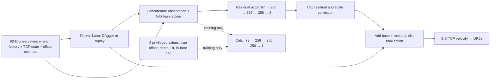

# Policy design: residual PPO for contact recovery

**The key choice: learn a correction to a useful policy.** A frozen DAgger student supplies the nominal action; PPO learns a bounded residual that can change lateral motion, descent and tilt when contact calls for recovery. The implementation also supports a force-limited replay base. Freezing the base preserves its behavior during RL training, while initializing the actor's mean near zero starts the mean controller close to that base.

## Policy architecture: what runs on the robot



| Component | Implemented architecture / contract |
| --- | --- |
| **Observation — 62 values** | Commanded and measured TCP position offsets (3 + 3); eight six-axis wrench samples (48); previous action (5); XY alignment estimate and availability flag (2 + 1). This is a stacked-history MLP, not a recurrent or image encoder. |
| **DAgger base** | `62 → 256 → 256 → 256 → 5`, ReLU hidden layers, tanh output; normalization fitted on aggregated training data. Frozen during PPO. |
| **Residual actor** | `67 → 256 → 256 → 256 → 5`, ELU hidden layers, tanh mean output; running input normalization. Training samples a Gaussian with learned per-action standard deviation (`log_std` initialized to −1.2); evaluation/deployment uses the mean. |
| **Asymmetric critic** | `73 → 256 → 256 → 256 → 1`, ELU hidden layers and separate running normalization. Its extra six inputs are true XY offset, depth, two tilt components and an in-bore flag. Used only during training. |
| **Action — 5 values** | Normalized TCP velocity `[vx, vy, vz, ωx, ωy]`; no learned yaw or gripper action. At default speed scale, full-action limits are ±6 mm/s laterally, ±8 mm/s vertically and ±0.1 rad/s in tilt. |

**Observation source matters:** the hardware path uses the registered rod position and nominal grasp to estimate alignment. It cannot directly see in-hand displacement. Some published simulation runs instead use an **oracle-derived noisy offset estimate**; those are explicitly separated in the [results table](EVALUATION.md#reproducible-simulation-reference). Privileged critic inputs never reach the exported actor, but that alone does not make an oracle-estimate experiment deployable.

For a base action `a_base`, normalized residual `u`, and elementwise scale `s`:

```text
u = clip(residual_actor(observation, a_base), −1, 1)
a = clip(a_base + s ⊙ u, −1, 1)
s = (0.6, 0.6, 0.6, 0.5, 0.5)
```

The scale bounds how much the residual can correct the base before final clipping. With the default velocity limits, that is up to **3.6 mm/s in X/Y, 4.8 mm/s in Z and 0.05 rad/s in tilt**. These bounds constrain commands; they do not guarantee a particular contact force.

Sources: [student](../contact_sim/student.py), [actor–critic and PPO](../contact_sim/ppo.py), [base policies / privileged vector](../contact_sim/base_policies.py), [training and action composition](../contact_sim/run_residual_rl.py).

## Reward design: seat the nut without rewarding a jam

The per-tick reward combines a terminal task outcome with dense progress and time-integrated costs:

```text
r = 10 · first_success − 10 · hard_failure
    + γ Φ(next_state) − Φ(current_state)
    − Δt · (0.1 + 2 · wrench_cost + λres · ||u||² + 0.02 · ||u − u_prev||²)
```

Here `γ = 0.99`, `Δt = 1/30 s` and the default `λres = 0.1`. The following are **implemented design choices and their intent**, not independently validated optimal weights:

| Choice | Implementation | Why this design |
| --- | --- | --- |
| **Reward geometric seating** | One-time **+10** when the rod is in the bore and depth reaches within 1 mm of the configured target (15 mm by default). | A large contact force alone must not count as successful insertion. |
| **Gate depth progress by alignment** | `Φ = −alignment_error + sigmoid((clearance − XY_error) / 0.2 mm) × depth_fraction`. Alignment is scaled by 2 mm and capped at 2; depth fraction is clipped to `[0, 1]`. | Give dense guidance toward alignment while reducing the depth incentive when the nut is outside the opening. |
| **Use potential differences** | Progress is `γΦ(next) − Φ(current)`; absorbing success/failure states have zero potential. Time limits bootstrap the critic instead of becoming hard-failure terminals. | Reward changes in progress rather than repeatedly paying for occupying a favorable state; distinguish timeout from physical failure. |
| **Penalize excessive wrench** | Sum squared excess above per-axis soft thresholds, normalized by the soft-to-hard span; average over physics substeps. Uses simulated wrench shifted to the TCP. | Permit useful contact while charging for sustained or brief excessive loads that a policy-rate sample could miss. |
| **Penalize hard failures** | **−10** on a force abort or invalid penetration beyond **0.5 mm**; invalid physics cannot count as success. | Prevent the learner from benefiting from simulated interpenetration or an abort. |
| **Keep corrections small and smooth** | Squared normalized residual size plus squared change from the preceding residual; a constant time cost discourages delay. | Encourage economical corrections and discourage residual chatter. Slew penalizes the **residual**, not the complete base-plus-residual command. |

The reward's soft wrench thresholds are `(5, 5, 8) N` and `(0.3, 0.3, 0.3) N·m`; its normalization upper thresholds are `(30, 30, 40) N` and `(2, 2, 2) N·m`. These are configurable starting choices. **The upper thresholds normalize the cost; they are not per-axis termination limits.** The simulation's separate default abort is a **40 N force norm**; the deployed controller has a separate **20 N hardware force stop**. Lower reward cost is therefore not a hardware safety guarantee.

Sources: [reward terms and defaults](../contact_sim/residual_reward.py), [environment success / abort logic](../contact_sim/contact_env.py), [offline reward checks](../contact_sim/test_contact_modules.py).

## Training recipe and the imitation-learning baseline

**PPO:** clipped objective (`ε = 0.2`), GAE (`γ = 0.99`, `λ = 0.95`), Adam at `3e−4`, five epochs and four minibatches per update, value-loss coefficient `0.5`, no entropy bonus, and gradient-norm clipping at `1.0`. The runner defaults to 128 parallel environments and 48 policy ticks per rollout chunk; `--lr-anneal` optionally decays the learning rate to 10% over the training budget. Completed-episode samples are masked from updates, and a small-batch guard avoids unstable updates when too few valid samples remain. Exact experiment overrides live in [`runs/`](../runs/).

**DAgger:** a privileged contact expert labels the states visited by the student. Four aggregation rounds reduce expert participation from **100% → 50% → 25% → 0%**, and the student minimizes action-matching MSE. The expert's decisions must be inferable from the student's inputs: a privileged alignment-gated hovering strategy produced a hovering student, while a contact-driven descend–release–shift strategy supplied more useful recovery behavior. See the [DAgger schedule](../contact_sim/dagger.sh).

**Why try residual RL after imitation?** DAgger optimizes agreement with expert actions; PPO optimizes the downstream insertion outcome under its own rollouts. That makes contact recovery under imperfect grasp, registration and sensing a useful target for residual learning. The preliminary hardware advantage is consistent with this motivation, but does **not** establish the mechanism: matched starts, force budgets and failure analysis are still needed to distinguish better recovery from simply pushing harder.


[← Project overview](../README.md) · [Framework](FRAMEWORK.md) · [Evaluation](EVALUATION.md)
