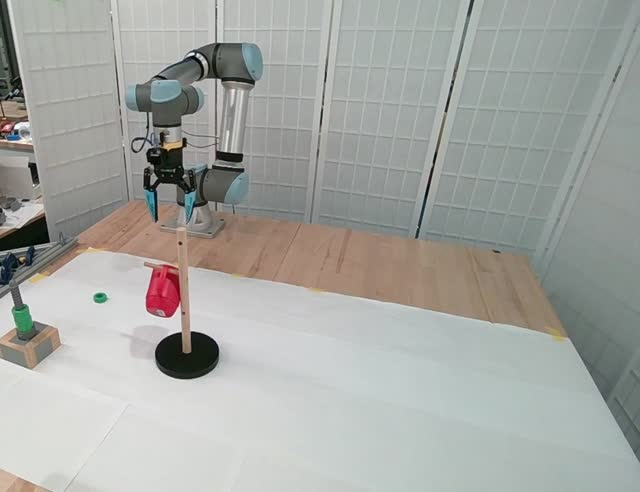
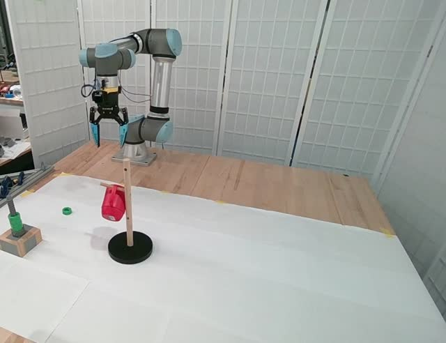
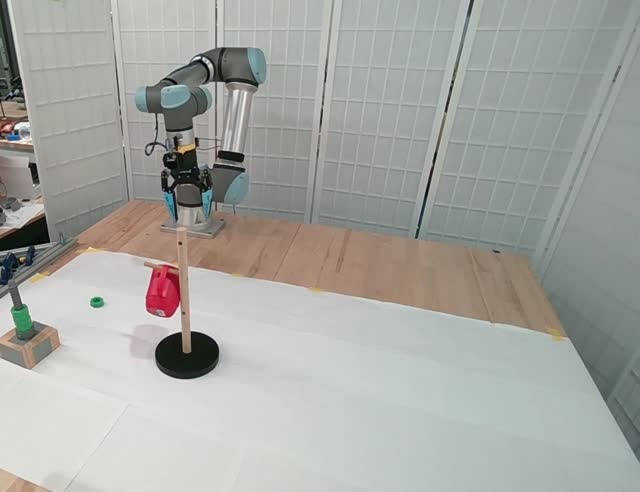

# Hardware evaluation footage

These are the supplied `force_rollout/videos` files, with original group and clip names retained. All 15 originals are included unchanged; [manifest.json](manifest.json) records their SHA-256 checksums, sizes, durations and codecs.

**Metadata pending:** group meanings, camera/trial mapping, policy and checkpoint IDs, start offsets, outcomes, force traces and termination reasons were not supplied. Fifteen files do not establish fifteen independent trials. These clips support qualitative inspection, not a paired baseline comparison or a hardware success rate. Video length is not a measured insertion completion time.

## Three previews

Each preview uses clip `0` from its numbered group, selected by filename rather than outcome. These H.264 copies retain the original frames and playback timing; only the MP4 container is remuxed for progressive playback. Posters are extracted at 2 seconds. Original HEVC clips may require downloading to a compatible player.

| Source group | Preview (click to open) | Clip length | All original clips |
| --- | --- | --- | --- |
| 0 |  | 26.50 s | [0](videos/0/0.mp4) · [1](videos/0/1.mp4) · [2](videos/0/2.mp4) · [3](videos/0/3.mp4) · [4](videos/0/4.mp4) |
| 1 |  | 22.23 s | [0](videos/1/0.mp4) · [1](videos/1/1.mp4) · [2](videos/1/2.mp4) · [3](videos/1/3.mp4) · [4](videos/1/4.mp4) |
| 2 |  | 28.43 s | [0](videos/2/0.mp4) · [1](videos/2/1.mp4) · [2](videos/2/2.mp4) · [3](videos/2/3.mp4) · [4](videos/2/4.mp4) |

See the [hardware evaluation protocol](../../HARDWARE_EVALUATION_TEMPLATE.md) for the metadata and matched trials needed for quantitative claims.
